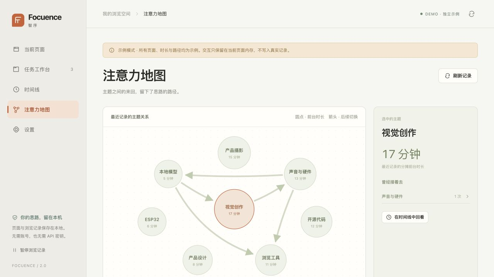

# Focuence V2 产品与 UI/UX 评审

> 历史快照：本文评审的是 2.0 基线。2.1 已按用户确认实现弹窗、侧栏与完整页三层形态，并关闭 B1–B3、增加任务恢复预览和具体路径证据。当前状态见 [V2.1 验证](V2_1_VALIDATION.md)；本文其余建议不等于本轮实施承诺。

2026-10-22 · 基于 2.0.0 附件源码及本轮界面截图。本文包含当前事实、待修缺陷和下一轮设计建议；建议尚未实现，也不代表已批准改版。

## 判断与定位

**这套可以作为 V2 基线。建议定位为「帮你接回思路的轻量浏览工具」。** 核心闭环是：快速收拢页面 → 保存一件事和下一步 → 随时接着做 → 回看当时的路径。

已有实现去掉了串行云端生成调用，使用规则先返回、本地向量按需增强，方向符合降低等待的目标。下一步的产品价值更依赖分类可纠正、任务可恢复和统计可信；单纯增加生成能力不会解决这些问题。

注意力地图适合作为回顾入口。预测作为用户主动选择的「继续线索」，先与最近任务、最近页面比较实际帮助；当前前台时长不能推断专注程度或完成状态。

## 已有能力与关键缺口

| 目标 | 已有实现 | 仍需补齐 |
| --- | --- | --- |
| 快速分组 | 规则建议先返回；BGE-small-zh-v1.5 q8 本地增强；持久向量缓存 | 真实 20/50/100 页的速度、内存和质量基准；建议成员调整；误分纠正 |
| 个人分类 | 固定主题正则及宽泛标签 | 自定义 tag、显式主 tag、人工覆盖与可追溯的标签来源 |
| 接着做 | 页面集合、备注、复用已打开页面；最多 30 页 | 最后停在哪页、下一步、恢复前的新增/复用页数预览、部分失败反馈 |
| 回顾路径 | 前台/暂离/未知片段；主 tag 有向转移；多 tag 时长分摊 | 地图时间范围、与时间线统一的聚合口径、具体片段证据、按任务查看 |
| 下一步线索 | 最近页面/任务；达到支持门槛后显示转移候选 | 时间顺序评测、停留时长条件、用户反馈；当前评分不是校准概率 |
| 数据连续性 | 本地存储、JSON 导出、保留期及清理 | JSON 导入与恢复验证；明确的版本迁移方案 |

本地模型目前只参与页面语义分组。tag 主要来自规则；访问先后和停留时间尚未反过来参与分组。不能将现有实现描述成「会持续学习个人工作流的分类模型」。

## 本轮截图与实际走查

内置浏览器，1280 × 720，`?demo=1`。全部页面、任务、时长与切换均为附件自带的合成数据，没有加载扩展去操作真实标签页。

| 步骤 | 操作与截图 | 本轮观察 |
| --- | --- | --- |
| 1 | [当前页面](reviews/v2-ui-audit/01-current-pages.png) | 导航和整理入口可达；首屏仅露出约两行页面，统计占位明显 |
| 2 | [保存任务对话框](reviews/v2-ui-audit/02-save-task.png) | 未选择页面时默认纳入全部 12 页；名称获得焦点，Escape 关闭后焦点返回；本轮取消，未保存 |
| 3 | [任务工作台](reviews/v2-ui-audit/03-tasks.png) | 卡片有继续入口和备注；推荐为空时顶部出现 `null` |
| 4 | [注意力地图](reviews/v2-ui-audit/04-attention-map.png) | 主题、时长、箭头和详情可见；时间范围仅写「最近记录」 |
| 5 | [地图进入时间线](reviews/v2-ui-audit/05-map-to-timeline.png) | 跳转携带主题并选择最近 7 天；页面顶部出现 `false` |
| 6 | [设置](reviews/v2-ui-audit/06-settings.png) | 记录/保留期/排除站点入口可达；保存按钮位于更下方，首屏不可见 |

### 当前页面

### 注意力地图

## 先处理的基线缺陷

这些是正式体验版前的待修项；本轮保留源码基线并记录问题，没有实施修复。

| 编号 | 证据与影响 | 修复验收 |
| --- | --- | --- |
| B1 · 界面显示内部值 | 任务页和时间线截图出现 `null` / `false`。`render()` 将可空 renderer 返回项直接传给 `replaceChildren`，浏览器把它们转换为文字 | 空推荐、无筛选、非截断记录和空态均不产生内部值文字；保留必要的空态提示与焦点行为 |
| B2 · GitLab 项目边界错误 | `src/text.js:projectIdentity` 在没有 `/-/` 的 GitLab URL 上仅取前两段。运行复现：`team/subgroup/project-a` 与 `project-b` 同为 `repo:gitlab.com/team/subgroup`，两个根页被合并；同项目的 `/-/issues` 又得到不同身份 | 多层子组的不同项目不合并；同项目根页与 issue 页身份一致；识别不确定时保守退让，增加相应回归用例 |
| B3 · 大记录地图统计口径不一致 | 代码链路：后台用近 7 天全量算 `transitions`，仅返回最新 2,000 条 `segments`；地图用这些片段重算节点时长。达到上限后，节点时长与箭头并非来自同一集合。此项为代码证据，尚未在真实大历史界面复现 | 后台按同一范围提供节点与边聚合；前端分页只影响记录列表；超过 2,000 条、跨日和多 tag 情况一致 |

## UI/UX 的改进方向

保留现有暖白、橙色强调和左侧导航。优先调整任务路径与可读性。

| 优先级 | 当前问题 | 建议改法 | 建议验收 |
| --- | --- | --- | --- |
| P1 | 当前页面首屏的页头、统计和大间距压缩了列表 | 将四项统计收成一行可折叠概况；搜索、页面列表和整理预览进入首屏；整理预览可收起或开抽屉 | 常用桌面尺寸首屏能看见首组完整操作与至少 5 行页面；保持标题可辨识 |
| P1 | `快速整理`、`应用分组`、`存为任务` 的结果不同，用户要自行理解 | 明确写成「生成分组建议」→ 检查/编辑成员 →「应用到浏览器」；任务保留是独立的后续选择；应用后给出页数、组名和撤销入口 | 用户在操作前知道会不会移动浏览器标签；默认只生成建议；能排除一个误分页面 |
| P1 | 未选中时「保存为任务」默认保存全窗口；任务页「保存当前页面」实际也可能包含多页 | 按范围显示「保存当前窗口 · 12 页」/「保存所选 · 3 页」；对话框可移除页面，超过 30 页时先说明上限 | 不会默默保存超出预期的页面；按钮、预览和实际保存页数一致 |
| P1 | 任务卡缺少「最后停在哪」和恢复成本 | 卡片突出最后访问页与下一步；按钮旁显示「复用 3 页，新开 2 页」；恢复后说明成功/失败情况 | 一个主要入口接回任务；不重复打开已存在的页面；失败可重试而不重复创建 |
| P1 | 地图不便回答某天在做什么，也缺少转移证据 | 增加今天/昨天/7 天与任务筛选；选中主题高亮入边/出边；选箭头展开具体访问片段；详情可回到对应时刻 | 节点、箭头、表格和时间线范围一致；次数能追溯到记录，低样本明确标注 |
| P1 | 辅助信息偏小、偏淡 | 正文/列表建议 14–16px，辅助信息约 12px；提高域名、标签、时间的对比度；细箭头扩大可点击范围；保留已有焦点样式和关系表格 | 实测文本对比与键盘路径；200% 缩放和窄窗口不遮住主要操作；不只靠颜色表达状态 |
| P2 | 设置修改和保存的距离较远；新用户不易理解记录范围 | 有更改时显示固定保存条；首次使用用一屏说明记录什么、如何暂停/排除站点，并提供创建首个任务的入口 | 修改后能明显看到未保存状态；空地图说明原因并提供下一步；重置后明确说明记录状态 |

辅助信息可读性有明确代码依据：域名采用 10px、`#979c8e` 对 `#f7f6f2`，计算对比约 2.60:1；标签采用 9px、`#7b8868` 对 `#eceedf`，约 3.21:1。这两个普通小文字样式低于常用的 4.5:1 检查目标。没有据此宣称完成全站无障碍审计。

## 注意力地图可以怎样衍生

| 方向 | 可落地的表现 | 数据/算法增量 |
| --- | --- | --- |
| 项目轨迹回放 · 优先 | 「上午先查电路，再看仓库，最后回到接线文档」；点击任一段接回页面 | 现有访问片段按工作时段归并，增加 task 关联和主题纠正；先用事实模板表达 |
| 每周回顾 · 其次 | 这周回到哪些项目、哪里反复切换、哪些资料值得保存；可手动收藏为任务 | 同口径聚合、工作时段切分、任务恢复记录；不把停留时间解释成效率评分 |
| 跨项目桥梁 · 其次 | 某份资料经常连接两个任务，提示「这页也可能对另一个任务有用」 | 比较访问转移和页面语义两类关系，界面分别标注；不要把先后当成因果 |
| 下一步线索 · 后续 | 正在做 A 时，给出少量可忽略的相关页面/任务入口，并说明出现依据 | 先以简单转移模型为基线，再尝试加入已停留时长、当前任务、时间段；数据稀疏时退回最近任务 |

预测需要按时间切分评估，避免把未来记录用于训练；对比「最近任务」「最常去的下一主题」等简单基线，观察候选命中和用户实际采纳。当前支持门槛只是防止凭空推荐，不代表预测已可靠。没有必要先引入生成式小模型。

## 建议下一轮范围与接口

以下是待确认的设计输入，不是本轮实施承诺。

1. **基线修复与验证**：关闭 B1–B3；在真实扩展中验证分组/撤销、任务恢复、后台重启、模型加载与释放。模型和离线架构保持当前方案。
2. **可纠正的分类**：提供自定义 tag、显式主 tag 和页面人工覆盖；至少支持建议成员移出与分组改名。人工决定优先于规则/向量建议，保留来源信息。
3. **恢复与回顾闭环**：增强任务的最后访问页和下一步；导出能导回并校验版本/格式；统一地图和时间线筛选；完成上述 P1 布局与可读性调整。

| 涉及模块 | 建议接口/职责 | 关键验收 |
| --- | --- | --- |
| `store/text/grouping` | 持久 tag ID、显式 `primaryTagId`、人工覆盖与分组约束；具体 schema 迁移需实施前确认 | 不依赖 tag 数组顺序；人工纠正不被下一次分析覆盖；不同项目边界保持有效 |
| `analytics/background` | 提供带明确 `range` 的同源节点、边和概况；记录列表独立分页 | 截断不影响聚合；多 tag 时长不膨胀；暂停/未知断开转移链 |
| `store/background/app` | 任务恢复预览与结果、最后访问页、JSON 导入校验；具体消息名待设计确认 | 导出→清空测试库→导入的任务/页面等价；重复导入不制造重复；非法导入不破坏现有库 |
| `app/popup` | 明确范围的操作文案、编辑建议、统一时间筛选、可见保存状态 | 从整理到保存、恢复、回顾的关键路径可用键盘完成；示例与真实模式清楚区分 |

需要明确的设计选择：纠正 tag 是否重算历史视图（建议保留原始观察，视图按选定的分类口径重算并标注）；恢复任务是原窗口还是可选新窗口；导入采用合并还是替换（建议默认可预览合并）。这些会影响数据模型与交互，应在实现前确认。

## 验证状态与建议指标

本轮已验证：原附件完整性、固定模型资产、锁定依赖安装、41 项逻辑测试、推理 worker/WASM 构建、离线包/源码包打包与内部文件哈希、上述六种示例界面状态。GitLab 问题另有独立函数运行复现。

待验证：真实扩展端到端、模型冷/热/缓存时延与峰值内存、20/50/100 个真实中英文混合页面的分类质量、超过 2,000 条历史、窄窗口/200% 缩放/读屏、macOS/Windows/Edge 差异。原包记载的 Linux 小样本性能数据不等于本机实测。

建议首先记录三项产品指标：分组被保留且未立即纠正的比例；恢复一个任务需要的操作数；能否在 30 秒内从回顾找到目标页面。都可以先通过本地测试和小规模体验反馈收集，无需新增云端遥测。

建议性能验收起点：20/50/100 页均不等待模型即可看到规则建议；规则路径 P95 先以 300ms 为目标，50 页全缓存语义路径 P95 先以 1s 为目标。它们是待基准设备验证的目标，不是已有测量结果；冷启动、峰值内存和释放情况应单列记录后确定上限。

建议按「修复与真机验证 → 可纠正分类与任务恢复 → 地图回顾 → 预测实验」推进。保留完整 V2 方向，同时让每一轮交付都有独立可用的结果。
