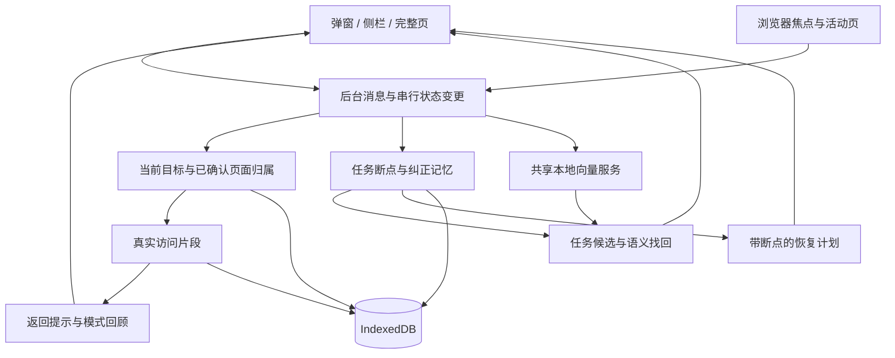

# Focuence 2.2：任务记忆与注意力支持

## 提案与确认范围

把现有页面整理、保存任务和浏览回顾连接成围绕用户目标工作的连续体验：选择任务 → 识别相关资料 → 留下断点 → 带着下一步恢复 → 记住用户纠正。加入语义找回、用户可开启的返回提示，以及有访问证据的个人工作模式回顾。

本方案覆盖上一轮讨论的五个方向，分阶段实施但全部进入本轮验收。用户于 2026-10-23 明确确认：“确认，按这份方案直接实现并完成验收，不用分步再问我。”新增模块、接口和验收条件已获批准；各实施单元完成情况以下文检查项为准。

六个实施单元已完成。113 项逻辑测试、构建、真实数据库与浏览器流程、实际本机模型、三端界面及边界验证全部通过；证据与限制见 [2.2 验收记录](../reviews/v2.2/README.md)。

保持本机架构及现有 BGE 向量模型。断点中的目标、已做到哪里、阻碍和下一步由用户填写或确认，系统自动整理已观察到的页面与时间证据。本轮不增加生成式大模型、网页正文抓取、云服务或浏览器权限；不会把向量检索包装成生成式摘要。

## 用户体验与需求追踪

| 编号 | 要解决的问题 | 本轮交付与完成标准 |
|---|---|---|
| R1 当前任务 | 已保存的页面集合没有表达本次工作的目标 | 可编辑任务目标；每个普通窗口明确选择一个当前任务，可切换、暂停和继续。共享页面不会被任意归到第一个任务 |
| R2 关联资料 | 同一任务的资料分散在多个站点 | 根据任务目标、已确认资料和页面短文本提供相关候选；显示依据，支持相关、不相关、撤销和重置关联记忆 |
| R3 工作断点 | 恢复标签后仍要重新想起做到哪里 | 保存用户确认的进展、阻碍、下一步及继续页面；自动观察线索与用户文字分开展示；恢复后可直接到对应页面 |
| R4 语义找回 | 记得意思却不记得页面标题 | 用自然语言查找本机已保存任务、备注和保留期内的页面元数据；结果能打开、定位所属任务和查看来源 |
| R5 返回支持 | 持续跨任务浏览后难以回到原目标 | 用户开启后，在侧栏低频提示返回；可标记相关、暂时忽略或关闭。无法判断时保持未知，不给专注分数 |
| R6 工作模式 | 原来的主题统计无法解释任务往返 | 回顾同一任务内浏览、不同已确认任务间的往返、离开后返回和重复找回资料；每条模式提供时间范围、样本量和记录入口 |
| R7 可靠性 | 多窗口、旧结果与数据清理可能破坏任务记忆 | 任务修订号与窗口上下文版本防止旧操作覆盖新决定；迁移、重启、暂停、删除及清理符合下文契约 |
| R8 三个入口 | 操作不能挤满窄侧栏或退回完整页才能做 | 弹窗提供当前任务及快速继续/留断点；侧栏承载完整工作流程；完整页提供找回、模式详情和记忆管理 |

### 一次完整使用

1. 用户保存或选择“完成登录改版”，填写目标“确认错误状态并交付设计”。选择当前任务不自动打开全部资料。
2. 侧栏展示当前任务、已确认下一步，以及来自当前窗口的相关候选。候选可跨站点，但未经确认不会写成历史任务归属。
3. 用户把设计规范标记为相关，把另一个项目的登录页标记为不相关。下次建议会使用这些决定；可以查看并撤销。
4. 用户暂停任务时，系统提供最后访问的相关页面与时间，用户填写或修改“做到哪里 / 阻碍 / 下一步”。切换任务时也保留观察线索；空闲和重启期间不补写虚构进展。
5. 回来后显示已保存的下一步和继续页面。“继续这个页面”只打开或复用这一页；原有“恢复任务页面”仍提供复用/新开数量及失败重试。
6. 用户可用“之前比较过的登录错误提示”查找资料。只有用户启用返回支持后，持续离开当前目标的已确认访问才可能产生提示。

## 调查依据

- 基线为 2.1.2，当前工作区 `main` 干净，沿用现有工作区。
- `src/tasks.js` 已有网址去重、恢复预览、继续页面选择和最近任务排序，可扩展而不重写。
- `background.js` 的 `currentContext` 目前取第一个包含页面的任务。新增明确任务意图后必须处理多任务共享页面，不能继续依赖数组顺序。
- `src/activity.js` 已按任务、页面、窗口、标题等身份变化分割片段，具备增加意图快照的基础。
- `src/store.js` 使用 IndexedDB，并在同一事务中保存活动状态和片段；当前任务结构清洗会丢弃未知字段，必须同步更新持久化与导出。
- `background.js` 当前向量入口过滤固定和已分组页面。该过滤属于原生分组保护，不能照搬到资料检索或任务关联。
- `inference/worker.js` 的实际能力是本地短文本向量计算。沿用固定模型、512 维向量、128 token 上限、短批次和缓存，不把它描述成生成模型。
- `app/app.js` 与 `popup/app.js` 已有草稿、焦点保持、恢复失败重试和暂停记录提示，应保留并覆盖新增状态。
- 研究与实现依据限于本仓库和下列公开一手资料；未读取日常浏览器资料或其他项目。

## 核心设计决定

| 决定 | 设计与理由 |
|---|---|
| 区分目标和观察 | 当前窗口选择的任务是意图；页面经确认属于哪个任务是观察归属。两者分别保存，避免把暂时无关的页面算成当前任务的工作 |
| 相关不等于全部恢复 | “相关 / 不相关”保存关联记忆；“保存到任务”才加入恢复页面集合，仍受 30 页上限约束。界面使用不同按钮与明确反馈 |
| 用户确认优先 | 明确关联决定优先于保存成员关系，二者都优先于模型；页面可同时属于多个任务。相似度不能覆盖用户排除，也不作为正确率展示 |
| 断点可追溯 | 用户文字、自动观察线索和模型关联建议分开；每个观察线索保留来源和时间。没有用户确认就不宣称已完成某个工作步骤 |
| 本地推理复用 | 抽出共享向量服务，按用途隔离输入和缓存键。规则结果先可用，语义结果异步补充，不阻塞保存、暂停与恢复 |
| 状态可恢复 | 工作上下文由带浏览器会话标识的本机数据保存，worker 回收可恢复；真实浏览器重启后仅提供恢复入口，不继承旧窗口 ID 的意图 |
| 主动支持克制 | 默认关闭；仅侧栏内展示，不新增系统通知、不打开侧栏、不强制切页、不关标签。未知关联不计为偏离 |

### 状态与数据流

下图用于说明模块边界和状态流向，不是实现代码。接口名称与字段语义以本文件契约为准，内部函数可以在实现时合理组织。

## 数据与生命周期契约

### 对象

| 对象 | 新增或调整内容 | 关键约束 |
|---|---|---|
| Task | `revision`、`goal`、用户确认的 `checkpoint` | 原任务名称、备注、30 个恢复页面及恢复结果完整保留；旧数据缺字段时按空值兼容，不把旧备注自动解释成已确认进度 |
| Checkpoint | 保存时间、用户进展/阻碍/下一步、继续页、证据引用、来源和确认状态 | 最新确认断点与自动观察草稿分开；自动更新不得覆盖用户文字；继续页必须由合法页面身份确定 |
| WorkContext | 浏览器会话标识、按窗口保存的当前任务、开始时间、上下文修订号 | 放在 `meta`，与任务切换相关写入统一事务；仅同一真实浏览器会话内恢复窗口绑定 |
| TaskRelation | 任务与页面的正/负决定、页面身份快照、时间、修订号及来源 | 新增 `taskRelations` store；多对多；明确纠正可以查看、撤销、重置；不训练或修改模型权重 |
| Segment | 保留 `taskId`，新增 `intendedTaskId` 与归属依据 | 当前意图不能自动成为实际归属；旧片段不重新归类，未知仍为未知 |
| Suggestion / SearchJob | 请求标识、数据代次、任务/上下文版本、来源、候选身份、处理进度 | 结果不构成用户决定；长检索采用短批次和游标，覆盖范围和取消状态可见 |
| SupportState | 开关、提示记录、冷却及暂缓状态 | 本机保存，不上报；按真实展示计频次，重渲染不重复计数 |

目标与下一步输入长度在持久化、后台和两端界面统一校验。原有备注完整保留；模型只读取按用途组织的短文本，截断不会反过来修改原文。具体长度属于实现参数，应在测试中覆盖边界。

### 页面归属

1. 先检查明确排除；没有排除时，有当前任务且页面已保存或被用户标记相关，才归到该任务。把已保存页面标为不相关不自动删除恢复成员，界面注明并提供单独移出操作。
2. 当前任务不包含该页，但该页仅明确属于一个其他任务时，可以记录该其他任务，同时保留当前意图。
3. 页面属于多个任务且没有明确选择时，归属未知，不取第一个匹配。
4. 模型候选未确认时不写入历史归属。确认从该时刻生效，不追溯重写过去片段。
5. 用户明确标记不相关后停止对该任务推荐此页面；主动重置或改正后才恢复。拒绝不会扩大为整个域名或其他任务的排除。

断点的继续页可来自已保存页面或用户确认相关的页面。单页继续可打开这一页；全部恢复始终只处理恢复集合中的最多 30 页。若断点页未在集合中，预览明确说明，可单页继续或先显式调整成员，不悄悄恢复第 31 页。

### 并发、迁移和清理

- 数据库结构由 1 升到 2，新增关联 store；只增加结构，不删除现有记录。升级被旧页面阻塞时显示可操作提示，不能退回假成功的内存数据。
- 导出格式升到 `schemaVersion: 3`，包含新增任务字段和手工关联记忆；临时窗口绑定、模型向量、检索查询与任务游标不导出。更新文档，不把导出文件冒充可导入备份。
- 任务变更、当前意图变更、删除与活动分段使用一致的串行顺序及短事务；外部 Chrome 操作和模型推理不能留在打开的 IndexedDB 事务里等待。
- 模型请求捕获数据代次和任务/上下文版本。任务修改、删除、切换、站点排除、清理或模型禁用后，旧结果不能重新出现或写回缓存。
- 清理历史删除片段、自动观察草稿、推断缓存、找回行为记录和提示记录；保留任务、用户确认断点与手工关联记忆。清理确认框明确说明保留项，并提供单独“清除关联记忆”和“清除全部”。保留断点只含用户主动确认的数据；原访问证据已清理时明确显示不可用。
- 删除任务同时移除其关联记忆、断点、派生向量和各窗口绑定；历史片段不回写，不再把已删除任务列成可恢复对象。
- 自动观察与搜索行为按现有历史保留期清理；用户手工记忆随任务保留。增加站点排除后，对新的采集、模型输入、结果和提示立即生效；既有手工保存内容保留可见，并沿用显式恢复能力，不再作为自动推荐输入。
- 暂停任务只停止当前窗口意图，仍遵循全局记录设置；暂停记录关闭自动观察、关联后台更新、返回提示与模式新增。手动编辑、显式检索、保存和恢复仍可用，并说明数据来源。

## 后台接口契约

沿用 `chrome.runtime.sendMessage` 与 `{ok, data, error, code}` 响应。写入由后台核验权威状态，不相信界面回传的页面标题、数量、模型分数或任务名称。界面兼容旧状态缺少新增字段。

| 消息 | 关键输入 | 返回与约束 |
|---|---|---|
| GET_STATE（扩展） | 窗口、日期范围 | 增加当前任务、断点摘要、关联候选状态、返回提示与任务模式；保持现有字段语义 |
| SAVE_TASK / UPDATE_TASK（扩展） | 目标及现有编辑字段；更新带任务修订号 | 校验后保存；两个入口同时编辑时拒绝旧版本并保留草稿 |
| SET_CURRENT_TASK | 窗口、任务 ID、期望上下文修订号 | 先结束旧观察片段、保留旧任务线索，再原子更新意图；不自动恢复全部页面 |
| PAUSE_TASK | 窗口、任务 ID、上下文修订号、可选已确认断点 | 保存成功才解除当前意图；失败保留界面草稿和原状态 |
| SAVE_CHECKPOINT | 任务 ID、期望任务修订号、用户字段、继续页及证据选择 | 核验页面与证据来源，不允许跨任务拼接过期数据 |
| SUGGEST_TASK_PAGES | 窗口、任务 ID、请求标识 | 规则和缓存先返回，语义处理异步补充；候选包含依据、身份快照、版本和覆盖情况 |
| SET_TASK_RELATION | 任务、页面或有效候选标识、相关/不相关、期望修订号 | 保存手工决定并更新后续候选；提供只针对该决定的撤销标识 |
| UNDO_TASK_RELATION / RESET_TASK_RELATIONS | 决定标识或任务、期望修订号 | 不覆盖之后的新决定；重置不删除已保存恢复页面 |
| UPDATE_TASK_PAGES | 任务、显式成员变更、期望修订号 | 对新增页面去重与校验，超过 30 页拒绝并说明，不静默截断 |
| RESTORE_TASK（扩展） | 任务、窗口、明确的继续页或全部页面模式 | 复用现有去重/重试逻辑；成功恢复后设为当前任务，全失败保留原意图；响应保留逐页结果与断点 |
| SEARCH_MEMORY / GET_SEARCH_STATUS / CANCEL_SEARCH | 查询、范围、请求标识或游标 | 关键词先可用，本地语义逐批补充；进度/部分结果/失败/取消可区分，迟到结果不覆盖新查询 |
| UPDATE_FOCUS_SUPPORT / FOCUS_FEEDBACK | 开关或提示标识、相关/忽略/暂缓选择 | 旧提示绑定原窗口和任务；标记相关只更新关联记忆，不自动加入 30 页恢复集合 |

统一补充 `STALE_TASK`、`STALE_CONTEXT`、`STALE_SUGGESTION` 等错误码；界面重新读取后让用户核对，保留未提交文字。只在实际结果成功后显示成功反馈。

## 模型、提示与回顾的边界

### 任务关联与语义检索

- 共享向量服务区分页面、任务目标和查询输入，缓存键包括用途、模型标识与文本哈希。查询向量不持久化原始查询。
- 任务关联使用目标与已确认资料的语义相似度，明确正/负决定优先；不照搬分组的同项目硬限制，否则跨站任务无法成立。
- 检索使用当前模型的查询格式，覆盖任务名、目标、用户备注、断点文字和可用页面短文本。中文为主要验收语言，短标题信息不足时允许无语义结果。
- 当前窗口、保存任务、保留历史作为可见检索范围。全部历史按短批次处理；不得默默只查前几百条再显示“全部完成”。关键词结果与语义结果注明依据，分数只用于排序。
- 页面和任务文本均为数据，不执行其中的指令。模型不开网页、不修改任务、不改变记录设置。

### 返回支持

- 默认关闭，用户可在侧栏或设置中开启。
- 建议初始条件：已有明确当前任务；连续有效观察至少五分钟，出现至少两个不同且明确属于其他任务或已被标记不相关的页面。未知页面、无记录间隔、快速掠过、系统空闲、失焦、暂停与重启打断累计。
- 初始频率上限：每三十分钟最多一次，每个本地日最多三次；忽略后进入冷却，暂缓可暂停到本次工作结束。这些是可调整的产品参数，不是科学判定阈值。
- 提示说明观察事实，提供“回到任务 / 这是相关调研 / 暂时忽略”。返回只打开或复用继续页，不恢复全部任务页面。

### 工作模式

- 按真实确认的任务归属统计同任务内浏览、跨任务切换及 A→B→A 往返；不把一次标签切换称为一次任务切换。
- 给出离开到再次观察到任务页面的时间，明确其为浏览记录间隔，不命名为心理恢复成本。跨缺测或重启不拼接。
- 只有同一模式在至少三个独立观察时段出现时，才给出重复模式说明；样本不足时展示事实记录和不足提示。
- 记录用户通过 Focuence 找回页面的本机操作，用于“重复寻找同一资料”和恢复操作数；普通网页访问不冒充搜索行为。查看结果不代表已经完成工作。
- 界面保留现有主题回顾，任务模式单独解释统计口径，并能定位原记录。没有任务绑定的旧历史不伪装成任务级洞察。

## 实施单元与验收

各单元由主线程顺序完成；没有获得新增 agent 或 worktree 的批准。实现中只有影响目标、架构、接口或权限的实质变化才重新确认。

- [x] **U1：数据迁移与工作上下文**（R1、R7）

  修改 `src/store.js`、`src/activity.js`、`src/tasks.js`、`background.js`；新增 `src/task-context.js`。测试 `test/task-context.test.js`、`test/task-memory-store.test.js`，扩展 `test/activity.test.js`。

  使用已有事务与纯状态机模式，补齐版本、明确意图和多任务归属；把任务写入与活动分段纳入统一串行边界。

  验收：从 2.1.2 数据升级后任务、备注、片段不丢；共享页面按当前任务归属，无当前意图时不任意分配；两个窗口独立；worker 回收可恢复，真实浏览器重启不复用旧窗口绑定；并发编辑旧修订被拒绝；事务失败不留下半个任务切换。

- [x] **U2：断点保存与继续**（R3、R7）

  依赖 U1。新增 `src/checkpoints.js`，扩展 `src/tasks.js`、`src/store.js`、`background.js`。测试 `test/checkpoints.test.js`、`test/task-memory-store.test.js`、`test/task-context.test.js`。

  复用实际恢复计划及逐页结果；用户断点和观察草稿分开，支持指定继续页面和原有全部恢复。

  验收：保存/编辑/暂停/切换后断点可恢复；自动观察不覆盖用户文字；重复点击或部分失败重试不重复开页；全部恢复失败不错误切换目标；原页面失效时给出可选择落点，不静默篡改下一步；暂停记录后不新增自动断点；删除与清理满足契约。

- [x] **U3：共享语义服务与关联记忆**（R2、R7）

  依赖 U1。新增 `src/semantic.js`、`src/task-matching.js`，扩展 `background.js`、`src/store.js`，必要时调整 `inference/worker.js` 的用途参数。测试 `test/task-matching.test.js`、`test/semantic.test.js`、`test/task-memory-store.test.js`。

  沿用已有 offscreen worker、短批次、缓存与数据代次；分组保护仍在分组路径，固定和已分组页面可参与检索与关联。关联候选与用户决定分开，支持撤销和重置。

  验收：跨站资料可匹配同一任务；明确排除高于模型；多任务共享页面不冲突；纠正重启后生效；撤销不覆盖后续决定；任务目标变更、导航、清理或禁用模型后旧推理结果失效；模型失败时明确回退，保存与恢复仍能操作。

- [x] **U4：语义资料找回**（R4、R7）

  依赖 U2、U3。新增 `src/memory-search.js`，扩展 `background.js` 和必要的存储查询。测试 `test/memory-search.test.js`、`test/semantic.test.js`。

  先返回关键词结果，再逐批补充语义结果；按页面身份去重，同时保留任务、备注与历史证据来源。复用 `OPEN_PAGE` 的网址验证与当前窗口去重。

  验收：同义表述能找到预设相关页面或任务，信息不足时不伪造正文命中；新查询不会被旧结果覆盖；取消后不继续展示旧任务结果；全部范围和处理进度准确；清理或排除后的内容不被旧缓存带回；失败有明确状态和重试入口。

- [x] **U5：返回支持与任务模式**（R5、R6、R7）

  依赖 U1、U2、U3、U4。新增 `src/focus-support.js`、`src/task-patterns.js`，扩展 `src/analytics.js`、`src/store.js`、`background.js`。测试 `test/focus-support.test.js`、`test/task-patterns.test.js`、`test/activity-analytics.test.js`。

  使用已确认归属和真实访问片段，采用有证据的确定性触发与聚合；语义模型负责相关候选，不能单凭低相似度判断用户偏离。

  验收：默认无提示；开启且满足条件时有一条侧栏提示；未知、暂停、空闲、缺测不触发；频率上限跨刷新有效；相关纠正生效、旧提示操作被拒绝；多页同任务不记为跨任务；模式样本和证据数量一致，不跨重启拼接；无记录与历史清理后显示空态。

- [x] **U6：三个入口与完整回归**（R1—R8）

  随 U1—U5 接入并最终统一验收。修改 `app/app.js`、`app/styles.css`、`app/demo-data.js`、`popup/app.js`、`popup/styles.css`，按需增加共享 `src/task-memory-ui.js`。扩展 `test/interface-contracts.test.js`、`test/review-surfaces.test.js`；新增 `test/task-memory-flows.test.js` 与独立浏览器验证材料。

  沿用当前视觉体系。侧栏任务页先展示当前目标、断点和继续操作，再展示相关候选；找资料使用独立可返回的视图。完整页增加模式详情和关联记忆管理。弹窗只保留短流程，复杂详情转侧栏。

  验收：320/360 像素侧栏、400×520/600 弹窗及桌面完整页可用；键盘、焦点、长中文、空态、加载、取消、失败重试和草稿保护齐全。刷新不能打断断点编辑。真实扩展完成“开始任务—关联纠正—暂停留断点—重启—恢复—语义找回—返回提示—清理”端到端流程，且原生分组、撤销、任务恢复和现有地图仍通过回归。

## 质量与验证口径

- 纯逻辑使用已有 Node 测试方式，针对状态边界、故障和并发写入测试，不只断言实现细节。
- IndexedDB 迁移与事务失败、真实窗口和标签操作必须在隔离浏览器中验证；不以 demo 传输冒充原生能力。仅为关键视觉及扩展流程验收使用浏览器自动化。
- 本地模型以固定、可检查的合成任务和页面集合验证，预先写明应命中与应排除项，覆盖跨站、中文同义查询、目标冲突及信息不足。必须实际调用模型并报告结果，不以成功返回向量替代检索效果验证。
- 在相同集合比较关键词与语义找回，记录命中、误命中、无结果、冷启动/缓存命中耗时；代表性用例不能区分相关与干扰时视为未通过，需要修正，不降低标准后宣称完成。
- 样本来源清楚标注为合成验证，不宣称已证明真实用户专注或效率提升。记录恢复操作数、检索结果与提示反馈；心理恢复时间只能通过用户反馈验证。
- 功能代码、测试、构建、必要界面和原生检查全部通过后交付；遗留必需问题明确列出。验证资料计划放在 `docs/reviews/v2.2/`。

## 系统影响与文档

| 影响面 | 必须保持的性质 |
|---|---|
| 分组与撤销 | 窗口/版本/成员身份绑定仍有效；不会因为抽出向量服务而丢失固定及原生分组保护 |
| 访问统计与地图 | 缺测仍为未知，旧主题转移口径不变；新增任务维度独立解释 |
| 任务与恢复 | 旧任务可继续；30 页恢复上限不放宽；相同网址不重复打开；部分失败可重试 |
| 隐私与设置 | 没有新权限或网络推理；新增记忆、导出、清理和暂停行为在界面中说明 |
| 推理生命周期 | 单一模型会话、可取消短批次、用途隔离、可见进度；不假定 worker 永远常驻 |
| UI 状态 | 三个入口共享同一后台权威状态；新增字段兼容，编辑冲突可恢复草稿 |

已同步更新 `PRODUCT.md`、`DESIGN.md`、`README.md`、`PRIVACY.md`、`docs/DATA_AND_ARCHITECTURE.md`；功能与必要验证通过后更新为 2.2.0。

## 实施结果与执行边界

本文件已获确认并完成五个方向：使用原有本机向量模型，断点采用用户确认文字与真实观察证据，返回支持默认关闭。新增协调器 `src/workspace.js` 统一状态变更，任务模式独立于原主题统计；这些属于批准模块内的组织方式。

参数已落实：任务名称 120、目标 1,000、笔记 20,000、断点字段 2,000 个 Unicode 码点；关联与检索每批 24 段，长任务文字 110 字、16 字重叠；提示五分钟、两个页面、每段至少十五秒、三十分钟冷却、每日最多三次。重复找回采用至少三个不同日期；语义分数只内部排序。

验收额外覆盖了目标先建、升级阻塞后的安全重试、超出时间线 2,000 条展示范围的模式证据，以及清理时迟到向量的阻断。完整检索验证为 113 个文本分段，worker 在 24 段后回收，继续完成全部范围。

沿用原 main 工作区，没有新增 agent 或分支/worktree。初次验收后，用户追加授权在原 main 分支提交与推送；打包和发布不在本轮范围内。自动生成实际进度、网页正文、云端模型及跨设备能力也不在本轮范围内。

主线程完成需求、状态边界、持久化、三端一致性与验收检查，不冒充独立 agent 评审。必要项无未解决阻塞；Windows/Edge、长期真实浏览和大规模性能未实测，合成样本不证明真实效率提升。

## 公开依据

- [Chrome service worker 生命周期](https://developer.chrome.com/docs/extensions/develop/concepts/service-workers/lifecycle)：后台会被终止，因此工作状态需持久化，长检索需分批且可恢复。
- [Chrome storage](https://developer.chrome.com/docs/extensions/reference/api/storage)：区分会话内数据与长期存储；浏览器会话结束不能沿用旧窗口绑定。
- [BGE-small-zh-v1.5 模型说明](https://huggingface.co/BAAI/bge-small-zh-v1.5)：用于文本向量、检索及相似度，沿用模型适用范围；具体查询格式在实现时按固定版本核验。
- [任务中断与恢复计划研究介绍](https://www.washington.edu/news/2018/01/16/task-interrupted-a-plan-for-returning-helps-you-move-on/)：支持设计恢复线索的方向，不作为本产品效果已经得到验证的证据。
