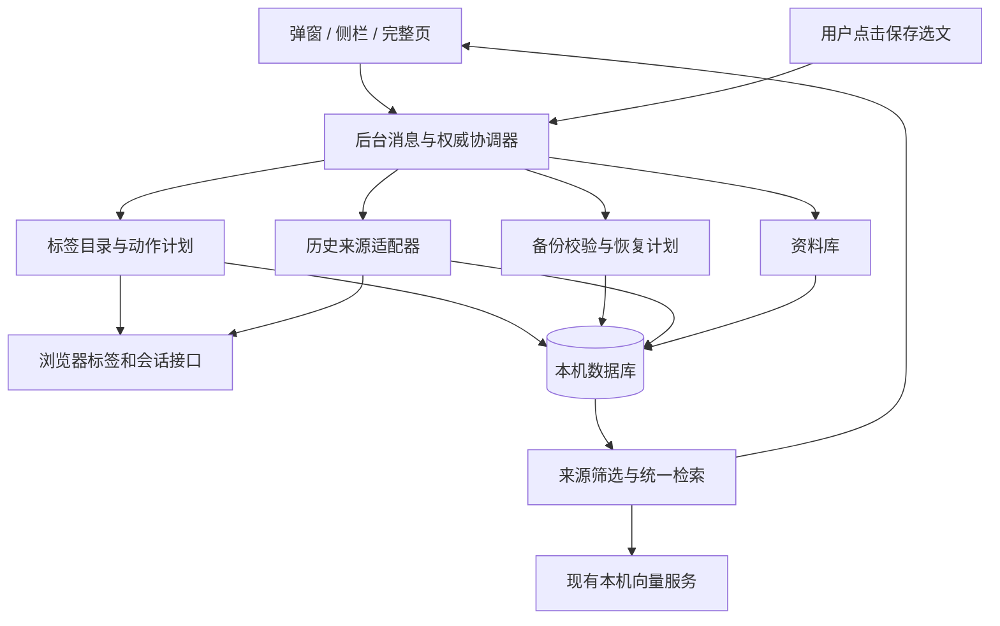
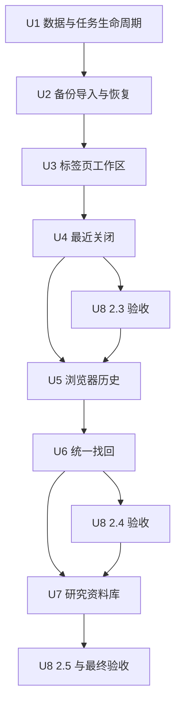

# Focuence 2.3—2.5：标签页工作区、历史找回与研究资料库

## 目标与确认范围

把 2.2 已有的任务、断点、页面关联和本机语义检索，延伸为三个连续阶段：管理当前标签页，找回以前看过的资料，积累用户主动保存的研究材料。完整路线包含下表三个版本，分阶段验收不减少最终范围。

用户于 2026-10-24 确认：“确认，按这份计划执行，三个阶段都做完并验收，每版通过后 commit push，不用再分步问我。”完整模块、接口、权限、验收与逐版提交推送已获批准，沿用 main 主线程执行。

| 阶段 | 用户能完成的工作 | 完成边界 |
|---|---|---|
| 2.3 标签页工作区与可靠备份 | 跨窗口找页；检查重复页；保存断点和页面后关闭；恢复本次关闭；查看最近关闭；管理等待、完成、归档；导入和恢复备份 | U1—U4 及该版本的 U8 验收全部通过 |
| 2.4 历史接入与统一找回 | 主动导入/刷新最近 7、30、90 天的本机浏览器历史；按来源、日期、站点和任务找回；打开对应页面 | U5—U6 及该版本的 U8 验收全部通过 |
| 2.5 研究资料库 | 保存链接、选文摘录和自己的笔记；关联多个任务；跨任务检索原文片段和来源；完整备份与恢复 | U7 及最终 U8 验收全部通过 |

上轮建议中的生成式问答和加密同步属于“之后考虑”的方向，本计划保留相应扩展位置，未把它们列为这三个版本的必需交付。本轮不引入账号、云服务、新模型、全网页抓取、全站脚本权限或团队功能。

## 需求与验收追踪

| 编号 | 需求 | 可观察的通过标准 |
|---|---|---|
| R1 标签页工作区 | 从当前窗口扩展到明确标识窗口的全局查找与选择 | 能定位并切换到其他普通窗口的页面；窗口范围和选择数量准确；无痕、排除站点及不可处理页面不会混入操作集合 |
| R2 保存后关闭 | 暂时不用的页面可安全收起，回来时保留任务语境 | 持久保存成功才发起关闭；操作前核对页面身份；失败显示逐页真实结果；中断后不会自动继续关闭；可恢复本次已关闭页面 |
| R3 最近关闭 | 找回浏览器仍保留的最近关闭条目 | 用户启用后才能读取；显示页面/窗口类型与实际数量；过期条目可刷新；不将该列表称为无限会话备份 |
| R4 任务生命周期 | 任务可以进行中、等待、完成、归档和重新开始 | 状态由用户决定；转换不删除资料；完成/归档释放当前窗口绑定；各入口一致；旧任务默认进行中 |
| R5 可靠备份 | 导出文件能实际导回，冲突与覆盖可审阅 | 支持旧格式迁移、合并与整体恢复；先预览再提交；失败不留下部分导入；保留恢复前快照；新版本用户资料全部可往返 |
| R6 浏览器历史 | 接入用户选定范围的已有本机历史 | 来源、覆盖日期和刷新时间可见；导入可取消、重试与恢复进度；权限拒绝、撤销、浏览器历史删除均正确处理；不生成前台时长 |
| R7 统一找回 | 当前页面、任务、访问记录、浏览器历史和资料库共用入口 | 同一资源保留多来源；过滤在检索前生效；时间解释可见可改；关键词先可用，语义覆盖完整选定范围；结果可打开或定位原记录 |
| R8 研究资料库 | 主动保存材料而不是依靠持续开着页面 | 选文和来源经用户确认保存；链接可独立收藏；正文与用户笔记分开；可跨任务复用；原网页变化不覆盖已保存摘录 |
| R9 可靠性与三端一致 | 在现有架构内可靠运行 | 迁移、并发、重启、迟到结果、清理和权限边界通过；弹窗、侧栏、完整页承担各自流程；旧功能完整回归 |

## 调查依据

- 基线为已推送的 2.2.0，原 `main` 工作区干净。已有 113 项测试、真实 IndexedDB、原生浏览器及实际 BGE 模型的验收记录，见 [2.2 验收记录](../reviews/v2.2/README.md)。本轮规划没有重新执行测试或把既有结果算作新功能通过。
- `background.js` 负责浏览器 API、活动队列与消息入口。`eligibleTabs` 当前只读指定窗口，`restorePages` 已能复用同窗口页面并逐页报告失败；新增跨窗口能力不能悄悄改变既有“保存当前窗口”的含义。
- `src/workspace.js` 已统一任务修订、窗口意图、断点、关联、检索任务与失效机制。新模块复用这一协调入口，避免把全部逻辑继续堆入 UI 或后台文件。
- `src/store.js` 当前数据库版本为 2、导出格式为 3；有原子提交，没有导入。`taskFrom` 会清洗字段，新增状态必须同时进入持久化、导出、兼容迁移和界面。
- `src/proposals.js` 的身份快照和过期拒绝可用于批量页面动作。`src/text.js` 的 URL 清洗会合并部分地址，不能直接用作破坏性去重的等价判据。
- `src/memory-search.js` 当前范围为当前窗口、任务、自记录访问和全部；不是浏览器 History API。`src/semantic.js` 已有用途隔离、短批次、缓存与旧结果保护。
- `src/task-memory-ui.js` 由三个入口共享；`app/app.js` 已有页面、任务、回顾、地图及设置，继续沿用中性工作台视觉和原生 HTML/CSS/JavaScript。
- 仓库没有匹配的 `docs/brainstorms/` 需求文档或 `docs/solutions/` 条目。来源为本次对话、当前仓库及文末 Chrome 官方接口文档；未读取个人浏览器历史或其他项目资料。

## 架构与关键决定

下图说明模块边界和数据方向，供审阅设计使用，不是需要逐字实现的代码规范。现有架构继续有效。

| 决定 | 实施约束与理由 |
|---|---|
| 保留权威协调器 | 所有用户数据变更经过后台队列与事务；浏览器副作用另有执行日志。UI 不能直接修改另一份任务状态 |
| 先持久化再关闭 | 数据库写入与浏览器关闭不可能成为一个原子事务；先保存完整恢复资料，再逐页执行，保留部分成功与中断事实 |
| 页面身份与重复判据分开 | 资料关联沿用清洗 URL；关闭重复页只建议完整浏览器 URL 相同的条目，保留参数和片段差异。标题相似、向量相近不构成关闭理由 |
| 任务状态与当前意图分开 | “进行中”是任务生命周期；某个窗口“正在做”是现有意图绑定。模型不决定完成、归档或关闭页面 |
| 新来源独立存储 | 浏览器历史不写入 `segments`；资料库不依赖历史保留期。统一检索合并展示时仍保留来源、时间类型和可追溯 ID |
| 权限按功能启用 | `sessions`、`history`、`contextMenus` 分别按需申请，拒绝后保留其他功能。不增加全站读取或脚本注入权限 |
| 导入先做计划 | 文件校验、迁移、引用核对、冲突处理与数据库写入分开；预览是具体变更集合，不能被后来上传的另一文件复用 |
| 三端共享行为 | 同一动作采用同一后台契约和共享组件；弹窗不承担大批量恢复冲突，侧栏与完整页可接续并保留明确上下文 |

### 标签页操作契约

1. 页面目录支持“当前窗口 / 全部普通窗口”，默认沿用当前窗口。每条页面带明确窗口归属。切换查看范围不更改已经确认的操作范围。
2. 批量动作采用“选择 → 预览 → 用户执行”。预览绑定会话、窗口、tab ID、完整 URL 的身份摘要、待导航状态和保护状态；执行前重新读取，身份变化必须重新预览，不能静默改成员。
3. 固定页、当前活动页、播放中的页面和已有原生分组的页面默认不选中，明确显示保护原因；需要纳入时由用户在预览逐项确认。无痕、排除站点、非 HTTP(S) 和仍在导航的条目不能纳入。
4. “保存并关闭”可新建任务或补充已有任务，带上用户确认的断点。保存清单继续最多 30 个不同资源；超限完整拒绝并让用户调整，不截断后继续关闭。
5. 在同一事务中保存任务、断点和恢复日志；写入失败关闭数必须为 0。随后每次关闭前再次核对目标，导航/关闭/移动事件使后续受影响动作停止。API 不提供原子身份比较与关闭，不能承诺消除最后一次核验与 API 执行之间的全部竞争窗口。
6. 操作日志分别记录待处理、已请求、已确认关闭、失败和状态不明。worker 回收或浏览器重启后只展示恢复/重新预览入口，不自动续关。日志写入失败时停止后续页面动作。
7. “恢复本次关闭”针对日志中的每个已关闭条目，保留原有重复页数量并记录新 tab ID，重试复用本次已恢复条目。旧窗口不存在时预览新的目标窗口；跨真实浏览器会话不得误用旧窗口 ID。
8. 原有“恢复任务页面”继续按网址去重；这与恢复一次关闭操作是两个清楚命名的动作。恢复页面只保证保存的网址及可恢复的页面组织信息，不声称保存表单内容、登录状态或完整页面运行状态。
9. 操作日志保留最近 30 天；任务和已确认断点独立保留。删除任务后日志仍可用于恢复网址，不恢复已删除任务的意图绑定。清除全部数据包含日志和恢复点。

### 任务生命周期契约

任务增加 `status`、`statusChangedAt` 和可空的 `completedAt`，状态为进行中、等待、完成、归档。旧任务默认进行中；不从访问次数或时长推导状态。

进行中任务可设为当前任务；等待任务可显式继续并回到进行中。完成、归档或转为等待时，一次性释放所有窗口中该任务的当前绑定，保留任务资料、断点和原始访问记录。重新开始完成/归档任务由用户触发，再选择是否打开资料。归档默认从日常列表隐藏，有明确筛选入口；全部资料检索仍可找到并标明归档状态。

### 备份与恢复契约

- 支持现有导出格式 2、3 和各新增版本的格式。未知未来格式拒绝导入并说明；不猜字段。旧数据缺少的新增字段使用兼容默认值，原有用户文字不能静默截断。
- 预览显示来源版本、任务/关联/访问片段/资料数量、重复项、冲突、无效项以及最终变更。无效 URL、畸形记录、重复标识冲突、悬空引用和不支持字段值须定位到具体记录；不能跳过错误后显示全量成功。
- 默认“合并保留本机”：完全一致记录去重；同任务 ID 的内容冲突默认保留本机，可逐项选择使用备份。替换任务时对应关联与断点一起形成一致计划。访问片段标识相同但内容不一致时阻止提交，避免重复累计或静默覆盖证据。
- “还原为备份”是明确的整体替换模式，预览将删除/替换的数量并再次由用户执行；不关闭浏览器标签页。
- 执行前校验预览 token、文件内容摘要与相关数据版本。合并期间新增的观察记录保留；影响冲突决定的任务/设置变化须重新预览。整体替换若预览后又有数据变化，须更新预览。
- 同一数据库事务保存恢复前快照并完成写入；任何一步失败均回滚。保存最近一个恢复前快照，存储空间不足时不开始覆盖。回到快照也走预览和确认，显示它之后新增的数据，避免把“回退”伪装成无损撤销。
- 导入不恢复临时窗口绑定、浏览器 tab/session ID、未完成页面动作、权限授予、提示冷却或向量缓存。恢复后旧检索、旧预览和迟到推理全部失效，当前观察重新建立。
- 导出覆盖用户任务、状态、断点、关联、扩展访问记录、资料库和普通设置；可重建的浏览器历史缓存、操作日志和内部恢复点不进入交换备份。合并默认保留本机设置，采用备份设置须在预览中明确选择；导入文件中的功能开关不能授予浏览器权限或自动启动历史导入。
- 恢复前快照只包含可交换的用户资料，不包含浏览器历史缓存和运行作业。清除历史时同时删除内部恢复点，并在清除确认中列明，防止随后回退又带回已经清除的访问记录；外部用户自行保存的备份文件不受扩展控制。

### 浏览器历史契约

- 功能默认关闭。用户选择最近 7、30、90 天并点击启用后申请 `history`；只导入本设备访问，排除无痕、排除站点及不支持协议。浏览器同步来的其他设备访问不作为本轮来源。
- 采用用户触发的导入/增量刷新，显示“覆盖范围”和“截至时间”；不自动补采暂停记录期间的历史。现有自记录访问继续按原记录开关工作。手动导入所选日期是一项单独明确的操作。
- 先按时间窗口枚举 URL，再读取实际访问事件并按所选范围过滤。API 默认返回条数不是全量；窗口达到批量上限时细分并去重。按原始 History/Visit 标识区分来源，用清洗 URL 建立资料关联。搜索的 URL 最后访问时间不能代替所有访问时间。
- 每批保存游标、范围、完成数量和代次；取消停止后续写入，重试幂等。不能枚举的边界或失败窗口显示未完成范围，不能把不完整结果标成“全部导入完成”。后台重启可继续读取，恢复前仍须检查权限与用户取消状态。
- 显示的网页标题来自浏览器返回的元数据，不伪称每次访问当时的完整标题快照。数据只提供访问时间与来源，不补出停留时长、任务完成度或历史意图。
- 缓存保留期采用用户选择的 7/30/90 天，并明确清理。收到浏览器删除历史事件后清理对应来源；导入和检索中的旧批次不得把已删除记录补回。对受影响地址重新核对实际剩余访问；每次手动刷新对所选范围完整对账，移除不再存在的访问。即时清理以浏览器提供的事件粒度为限，未报告的变化在刷新时对账，界面保留快照截至时间。
- 撤销权限或关闭功能会取消读取并删除该来源缓存与相关派生索引；用户主动保存到任务/资料库的内容继续保留。手动“清除历史”同时清除自记录和浏览器历史缓存，但不会调用删除浏览器历史的 API。
- 最近关闭独立使用 `sessions`，按浏览器返回结果展示，最多 25 条；不读取跨设备会话，不承诺找回浏览器已经丢弃的条目。窗口条目包含排除站点或不支持页面时，明确显示有成员未列出，禁用整窗原生恢复，只允许逐项打开已列出的合法网址；不把这一回退称为完整会话恢复。

### 统一检索与资料库契约

- 来源包含当前窗口、其他窗口、任务与已确认关联、自记录访问、浏览器历史、资料库。页面去重后仍列出所有来源；摘录有独立身份，不能被同 URL 的页面结果吞掉。
- 日期、域名和任务筛选在构建候选集合前执行。日期作用于来源实际时间：访问时间、保存时间或修改时间，界面明确标注，缺失时间不猜测。
- “昨天 / 上周 / 最近 N 天”等常见日期表达采用可解释规则，转成可编辑筛选项；不明确的表达保留为查询文字，不用隐式模型猜时间。
- 对自记录访问，“当时任务”依据原始片段；对历史/收藏，“关联任务”依据已确认资料关系。两种过滤语义分开，不能把今天的关联写成过去确实在做该任务。
- 保留关键词优先、短批次语义增强、取消、进度、失败重试和完整范围覆盖。结果分页不等于截断待检索语料；所有来源变化通过统一代次让旧查询失效。
- 资料库支持链接和摘录；摘录保存原文、清洗后的来源地址、标题、保存时间及用户笔记，笔记与原文分栏。可关联多个任务；删除任务只移除关联，不删除材料。
- 通过可选 `contextMenus` 提供“保存选中文字”。仅在用户点击后接收选文，排除可编辑输入区域，打开扩展内确认草稿。保存前可检查来源和选择任务，不读取整页，不注入脚本。跨源 frame 选文保留实际 frame 来源及所在页面，来源无法确定时要求用户核对，不把父页面标题伪作摘录正文的标题。未启用右键入口时仍可在资料库手动添加链接或粘贴摘录。
- 选文和笔记分别最多 20,000 个 Unicode 码点；超限保留草稿供用户调整，不静默截断。暂存草稿只留在当前浏览器会话，15 分钟未保存即失效；正式保存后不随历史保留期删除。
- 重复链接或同来源同原文的摘录提供复用提示，新增任务关联不重复生成材料。修改或删除材料同时使对应索引失效；网页内容后续改变不会自动改写本机原文。

## 模块与接口

接口名称用于界定职责，内部函数可以在不改变契约的前提下调整。所有接口沿用 `{ok, data, error, code}` 响应约定。

| 模块 | 职责 | 主要消息/输出契约 |
|---|---|---|
| `src/tab-workspace.js` | 跨窗口目录、严格重复候选、动作快照与恢复计划 | `LIST_WORKSPACE_TABS` 返回窗口分组与保护原因；`PREVIEW_TAB_ACTION` 返回成员、保存目标、影响数量和 token |
| `src/tab-operations.js` | 保存后执行、逐页日志、中断核对与恢复 | `EXECUTE_TAB_ACTION` 只接收已预览 token；`GET_TAB_OPERATION`、`RESTORE_TAB_OPERATION` 返回逐页状态及真实数量 |
| `src/task-lifecycle.js` | 任务状态转换与当前绑定约束 | `SET_TASK_STATUS` 携带任务修订与目标状态，统一更新全部受影响窗口 |
| `src/backup.js` | 文件格式迁移、完整校验、冲突与引用计划 | `PREVIEW_IMPORT` 返回不可变计划；`APPLY_IMPORT` 校验 token/版本；`PREVIEW_RESTORE_POINT` 复用同一流程 |
| `src/browser-history.js` | 可选权限、历史导入游标、删除核对、会话适配 | `START_HISTORY_IMPORT`、`GET_HISTORY_IMPORT`、`CANCEL_HISTORY_IMPORT`；`LIST_RECENTLY_CLOSED`、`RESTORE_RECENTLY_CLOSED` |
| `src/search-sources.js` | 来源契约、筛选、日期解释与分页 | 扩展 `SEARCH_MEMORY` 的来源与过滤参数；结果携带来源证据、时间类型、窗口/任务/材料入口 |
| `src/library.js` | 链接、摘录、任务关联和修订校验 | `SAVE_LIBRARY_ITEM`、`UPDATE_LIBRARY_ITEM`、`DELETE_LIBRARY_ITEM`；原文与用户笔记独立字段 |
| `src/store.js`、`src/workspace.js` | 迁移、事务、代次、清理与备份一致性 | 业务提交不绕过持久层约束；浏览器 API 调用不混入数据库事务 |
| `src/tab-workspace-ui.js`、`src/library-ui.js`、现有共享 UI | 三端展示、预览、草稿、键盘与错误恢复 | 一套行为规则，依入口空间展开；权限申请必须在用户点击处理链中直接触发 |

过期页面计划、任务冲突、导入校验失败、导入预览过期、权限缺失、历史范围未完成和材料旧修订分别返回可识别错误码。界面保留草稿并给出重新预览、重新读取、重试或开启功能的对应动作；不能把失败统称为“成功但略过部分项目”。

### 三个入口的布局职责

| 入口 | 本轮增加的主要交互 |
|---|---|
| 工具栏弹窗 | 快速找页和跨窗口定位；所选页面保存/关闭预览；最近任务状态与继续；单条材料保存。大批量导入转入完整页并说明目标，不在窄弹窗堆冲突表格 |
| 原生侧栏 | 页面窗口范围与任务选择；保存断点及关闭/恢复结果；来源筛选与统一找回；摘录核对与材料关联，保持浏览页面旁的持续工作流程 |
| 完整页 | 多窗口目录与重复页管理；任务状态筛选；资料库管理；历史连接/进度/清理；备份冲突与整体恢复。沿用现有页面、任务、找回、回顾和设置组织，只为资料库新增必要入口 |

切换入口保留明确的窗口、任务或材料 ID；失效对象提示重新选择。按钮名称区分“恢复任务页面”“恢复本次关闭”“恢复最近关闭”，不共用一个含义不明的恢复动作。

### 数据演进

| 版本 | 数据结构 | 导出格式 |
|---|---|---|
| 2.3 | 数据库 2→3：任务状态；`tabOperations`、`restorePoints`；必要的数据版本元信息 | 3→4；增加任务状态，支持旧格式 2/3 导入 |
| 2.4 | 数据库 3→4：`browserHistory`、`historyImports`；访问时间与来源索引；历史连接设置 | 4→5；记录兼容设置，浏览器历史缓存不导出 |
| 2.5 | 数据库 4→5：`libraryItems` 及其任务关联/更新时间索引 | 5→6；加入材料原文、来源、笔记和关联 |

允许从现有数据库版本直接升级到最新版本。迁移幂等，不以清空数据库解决升级问题；阻塞升级继续使用既有关闭其他页面后重试的提示。新增数据写入错误不得回退到临时内存后宣称成功。

## 实施单元与依赖

下面是依赖关系。各单元包含对应入口的可用流程，U8 负责阶段与最终整体验收，不把全部界面工作留到最后。

- [x] **U1：持久化基础与任务生命周期**（R4、R9）

  **目标与依赖：** 从 2.2 基线迁移，建立后续动作和恢复需要的可靠状态；无前置单元。
  **文件：** 新增 `src/task-lifecycle.js`；修改 `src/store.js`、`src/workspace.js`、`src/tasks.js`、`src/task-memory-ui.js`、`app/app.js`、`popup/app.js`；测试 `test/task-lifecycle.test.js`、`test/workspace-migrations.test.js`。
  **方法与既有模式：** 复用任务修订和 `commitWorkspace` 原子提交；任务状态和窗口意图独立，列表筛选/状态操作同步落地。
  **测试场景：** 旧任务及长笔记升级后完整；两个窗口同时绑定的任务完成后一次释放；旧修订修改被拒；等待/归档重新开始；事务故障无半更新；升级被阻塞后可安全重试。
  **通过标准：** 状态操作在三个入口一致，旧数据库可升级且旧功能继续读取。

- [x] **U2：备份校验、导入和恢复前快照**（R5、R9）

  **目标与依赖：** 在增加页面关闭前补齐可靠恢复；依赖 U1。
  **文件：** 新增 `src/backup.js`；修改 `src/store.js`、`src/workspace.js`、`background.js`、`app/app.js`；测试 `test/backup.test.js`、`test/backup-store.test.js`。
  **方法与既有模式：** 解析与验证先于写事务，沿用修订冲突和迟到结果失效机制；完整页展示文件预览、冲突选择、合并/整体恢复与恢复点。
  **测试场景：** 格式 2/3/4 往返；相同备份重复导入无重复统计；任务冲突选择保留/替换；关系悬空、片段冲突、损坏 JSON、未知版本、超长字段明确失败；预览过期重读；配额/事务失败保持原库；恢复点回退前展示新数据；清除历史同时使内部恢复点失效；导入不自动打开页面或授予权限。
  **通过标准：** 任务、文字、断点和证据可实际导回，任何失败都不留下部分写入；导出文件原样保留供用户处理错误。

- [x] **U3：跨窗口标签页工作区与保存后关闭**（R1、R2、R9）

  **目标与依赖：** 形成完整的查找、预览、保存关闭和恢复流程；依赖 U1、U2。
  **文件：** 新增 `src/tab-workspace.js`、`src/tab-operations.js`、`src/tab-workspace-ui.js`；修改 `background.js`、`src/store.js`、`src/workspace.js`、`app/app.js`、`popup/app.js` 及对应样式；测试 `test/tab-workspace.test.js`、`test/tab-operations.test.js`。
  **方法与既有模式：** 扩展现有页面视图，复用 `src/proposals.js` 的身份核验思路；先存完整恢复日志，再逐页执行浏览器副作用；近期动作可查看和恢复。
  **测试场景：** 三个窗口含相同 URL；同标题不同 URL 不作为重复；参数/片段差异不能自动合并；导航、移动、固定、分组改变使预览失效；第 31 个不同资源拒绝且不关闭；存储失败关闭数为零；关闭部分失败；最后一个标签关闭后窗口消失；worker 在已请求/已关闭之间回收；两次恢复不重复打开，恢复重复页数量符合日志。
  **通过标准：** 操作范围和真实结果一致，重启不会自动续关，保存页面与恢复日志均可追溯。

- [x] **U4：可选最近关闭恢复**（R3、R9）

  **目标与依赖：** 补充浏览器提供的近期会话入口；依赖 U3。
  **文件：** 新增 `src/browser-history.js` 的会话适配部分；修改 `manifest.json`、`background.js`、`src/tab-workspace-ui.js`、`app/app.js`；测试 `test/recent-sessions.test.js`。
  **方法与既有模式：** `sessions` 声明为可选权限；从用户点击申请，按原始会话条目恢复，不用扩展任务列表冒充最近关闭列表。
  **测试场景：** 权限拒绝/撤销、空列表、页面条目、窗口条目、超过返回上限、条目过期、恢复失败后刷新、窗口含排除/不支持页面时不泄漏其详情且不能整窗恢复绕过过滤；不调用跨设备会话接口。
  **通过标准：** 真实原生浏览器中能展示并恢复明确选择的条目；任务恢复在无此权限时仍可用。

- [x] **U5：历史来源与可恢复导入**（R6、R9）

  **目标与依赖：** 接入用户选定日期的本设备浏览器历史；依赖 2.3 验收。
  **文件：** 扩展 `src/browser-history.js`；修改 `manifest.json`、`background.js`、`src/store.js`、`src/workspace.js`、`app/app.js`；测试 `test/browser-history.test.js`、`test/history-import-store.test.js`。
  **方法与既有模式：** 独立来源表、时间索引和持久游标；复用短批次和代次失效，设置中显示范围、刷新、取消、断开和清理。
  **测试场景：** 7/30/90 天边界与同时间戳；结果超过 API 默认 100 条；同 URL 多次访问；同步自其他设备的访问排除；返回条数饱和时分窗；工作进程重启后续传；取消后迟到批次；权限中途撤销；浏览器单项/全部删除；排除站点变更；不完整范围不能报完成；未观察的时间不进入前台统计。
  **通过标准：** 合成浏览器历史与导入结果逐项比对，日期和来源准确；清理后无法通过旧索引找回已删除缓存。

- [x] **U6：统一搜索、来源与过滤**（R7、R9）

  **目标与依赖：** 让历史接入成为可直接使用的找回能力；依赖 U5。
  **文件：** 新增 `src/search-sources.js`；修改 `src/memory-search.js`、`src/semantic.js`、`src/workspace.js`、`src/task-memory-ui.js`、`app/app.js`、`popup/app.js`；测试 `test/search-sources.test.js`、`test/memory-search.test.js`、`test/search-filters.test.js`。
  **方法与既有模式：** 先筛选来源集合，再分段与排名；延续原查询任务、分页、取消和关键词回退；区分访问时间与资料时间。
  **测试场景：** 同 URL 来自多个窗口/任务/历史时保留全部来源；时区和夏令时的“昨天/上周”；任务历史归属与当前关联不同；第一个结果页之外仍可命中；关键词未命中的已知同义样本；模型失败时过滤不失效；切换条件、删除来源和新查询阻止旧结果覆盖。
  **通过标准：** 选定范围实际全部检索，结果可打开原页面并定位来源；日期筛选与显示一致。

- [ ] **U7：主动采集与研究资料库**（R8、R5、R7、R9）

  **目标与依赖：** 让主动保存的材料成为跨任务可复用的长期资料；依赖 2.4 验收。
  **文件：** 新增 `src/library.js`、`src/library-ui.js`；修改 `manifest.json`、`background.js`、`src/store.js`、`src/backup.js`、`src/search-sources.js`、`src/memory-search.js`、`app/app.js`、`popup/app.js` 及样式；测试 `test/library.test.js`、`test/library-capture.test.js`、`test/library-search.test.js`。
  **方法与既有模式：** 可选右键选文进入确认草稿；共享表单和修订冲突处理；材料与任务多对多，向量分段覆盖摘录和用户笔记，扩展备份格式。
  **测试场景：** 手动链接、右键选文、跨源 iframe 来源区分、可编辑区域拒绝、超长中文/emoji 保留草稿、恶意 HTML 作为纯文本显示；同文重复提示；多任务共享；删除任务保留材料；网页改变不改原文；修改/删除使旧结果失效；长摘录末尾命中；格式 2—6 导入及新格式往返。
  **通过标准：** 用户可完整完成采集、核对、关联、检索、打开来源与备份恢复，不依赖全站读取权限。

- [ ] **U8：阶段验收、文档和交付**（R1—R9）

  **目标与依赖：** 在 2.3、2.4、2.5 各阶段执行对应验收，最终检查完整路线；分别依赖 U4、U6、U7。
  **文件：** 更新 `README.md`、`PRODUCT.md`、`DESIGN.md`、`PRIVACY.md`、`docs/DATA_AND_ARCHITECTURE.md`、`manifest.json`、`package.json`、`package-lock.json`；新增 `docs/reviews/v2.3/README.md`、`docs/reviews/v2.4/README.md`、`docs/reviews/v2.5/README.md` 和证据；原生流程记录在 `test/native/browser-workspace.mjs`、`test/native/history-library.mjs`。
  **方法：** 继承既有真实扩展/数据库/模型验证方式，使用隔离浏览器和合成资料；主线程实施与自检，不将其称为独立评审。
  **测试场景：** 原有 113 项逻辑回归及新增必要测试；真实数据库升级/导入/配额故障；原生多窗口关闭恢复和最近关闭；真实历史删除/权限拒绝与撤销；真实选文菜单；实际 BGE 检索；320/360 像素侧栏、400×520/600 弹窗、1440×950 完整页的键盘、草稿、空/加载/失败状态；原分组保护与撤销、地图及返回提示回归。
  **通过标准：** 每版必要项全通过后才更新完成状态；保存截图、原始结果和环境限制。最终完整路径为“留断点并关闭 → 恢复 → 从历史找页 → 保存摘录 → 跨任务找回 → 导出与恢复”。

## 数据、权限与系统影响

浏览器标签事件、权限变化、历史删除、资料修改、恢复导入和数据清理都会影响检索代次。队列只串行关键状态提交，不在执行整批推理时占住编辑任务或暂停记录。长操作的 UI 显示已经处理的数量和剩余范围，不把模型相似度、访问次数或恢复次数当作正确率和工作产出。

| 触发 | 清理/保留规则 |
|---|---|
| 清除历史 | 删除自记录访问、浏览器历史缓存、相关自动线索、派生索引和内部恢复点；保留任务、确认关联、资料库与页面恢复日志 |
| 关闭历史功能或撤销权限 | 停止导入并删除浏览器历史来源；保留主动保存的任务/材料；既有自记录开关独立 |
| 删除任务 | 释放窗口绑定、删除该任务关联；保留共享材料、原始访问事实与独立页面恢复日志 |
| 清除全部 | 删除所有本机数据、恢复点、操作日志和临时作业；不调用浏览器历史删除或自动关闭页面 |
| 导入/整体恢复 | 清理旧缓存和运行作业，解除临时绑定，重新建立观察；不能自动申请权限或恢复未完成关闭动作 |

## 验证规模、风险与实际限制

- 功能样本覆盖 3 个窗口、100 个合成标签；导入/筛选样本至少 10,000 条访问；本机检索单独记录 1,000 个资源的首轮、缓存和取消响应。记录实际时间与内存观察，不提前编造秒数承诺。更大数据量若发现必须的性能问题，继续在已确认模块内修复，不用截断语料掩盖。
- 现有 URL 清洗可能去掉临时认证参数；关闭预览需区分资源身份与原始标签身份，并说明恢复网址的实际限制。不能以“已保存”为由承诺恢复网页未保存的表单内容。
- 原生最近关闭是浏览器有界列表；扩展自己的恢复日志负责本次关闭操作的持久追踪，两者不能互相替代。
- 历史删除事件与导入可能并发；需要删除代次/重新核对，不能让迟到批次复活被删除数据。浏览器未提供的历史信息明确缺失，不推测补齐。
- 整体恢复会覆盖本机资料，因此必须有具体预览和可用恢复前快照；配额不足时保留原数据并报告，不跳过快照继续覆盖。
- macOS Chrome 的原生验收为本机可执行基线；Chrome 最低版本接口兼容性逐项核对。Windows、Edge 或长期真实使用没有实际执行时如实标记，不冒充通过；不读取个人历史作为测试材料。
- 用户效率指标为找回资料耗时、恢复任务操作数、关闭后接续成功情况；合成测试只能证明流程与边界，真实收益需日常使用反馈，不新增遥测。

## 执行与交付约定

本文件已获完整确认，包括三个版本范围、保存后关闭、导入覆盖与恢复前快照、按需权限和阶段 commit/push。2026-10-24 已完成 2.3 的 U1—U4 及阶段验收，见 [2.3 验收记录](../reviews/v2.3/README.md)；2.4 的 U5—U6 通过 140 项逻辑测试、构建、10,000 次真实合成访问逐项比对、三端来源、删除/撤权/重启和实际模型检查，见 [2.4 验收记录](../reviews/v2.4/README.md)。1,000 资源完整处理、缓存和取消响应已实测，宽泛查询的排序限制保留在报告中。U7 与最终 U8 继续执行。

确认本计划后，按 U1→U8 和版本依赖连续实现、修复、验证，不在每个单元重复询问。内部函数命名、组件小幅拆分、批量参数等可逆实现细节由主线程处理；若新增数据来源、权限、云服务、模型或改变覆盖/关闭规则，才重新确认受影响部分。

沿用原 `main` 工作区，不新增 agent、分支或 worktree。每版验收后的 commit、push 已获明确授权；本计划随 2.3 源码交付并继续更新。ZIP 打包、商店上传和发布不包含在执行范围。

主线程已对照需求、接口、持久化、三端流程与失败边界进行规划自检；没有独立 agent 评审。运行中的行为和性能必须在实施时实测，本文件不把它们写成已验证事实。

## 一手参考资料

- [Chrome Tabs API](https://developer.chrome.com/docs/extensions/reference/api/tabs)：标签元数据与浏览器操作。
- [Chrome Sessions API](https://developer.chrome.com/docs/extensions/reference/api/sessions)：最近关闭及会话恢复，返回数量限制。
- [Chrome History API](https://developer.chrome.com/docs/extensions/reference/api/history)：URL 查询、逐次访问、本设备标识、删除事件。
- [Chrome Permissions API](https://developer.chrome.com/docs/extensions/reference/api/permissions)：可选权限声明、用户手势申请、权限撤销。
- [Chrome Context Menus API](https://developer.chrome.com/docs/extensions/reference/api/contextMenus)：用户点击时的选文、来源及可编辑区域标识。
