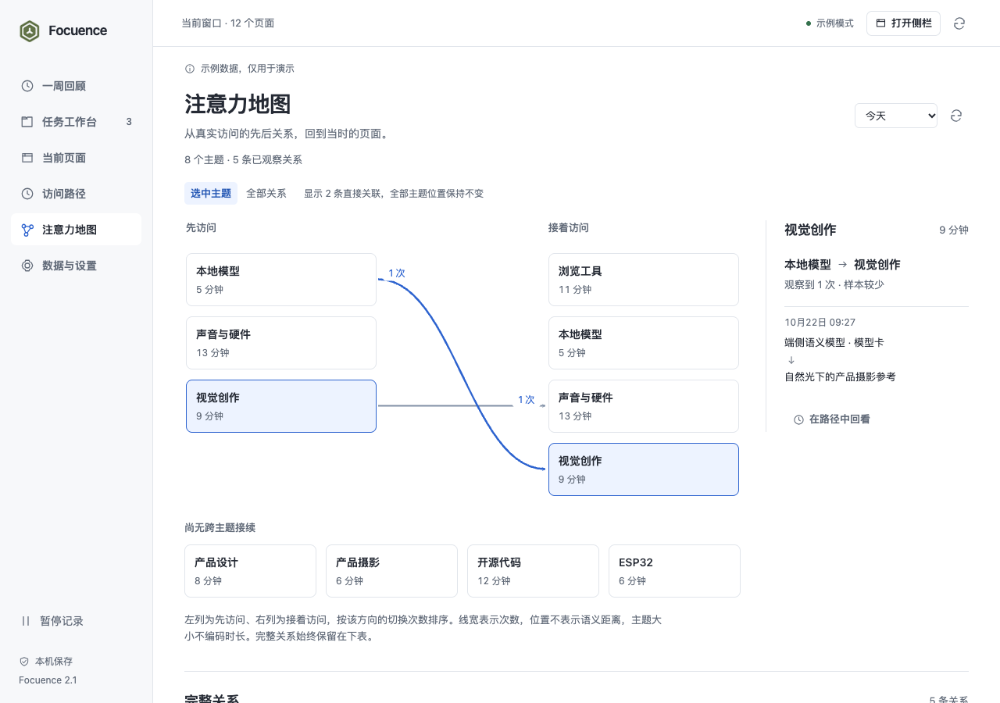

# V2.1.1 · 弹窗与侧栏整改

2026-10-22。依据 `b2f9de8` 版本的第二轮独立 Taste / Impeccable 评审继续实现，沿用已确认的三层插件架构。本文是主线程的整改与验证记录，没有重新派发评审或生成新的启发式评分。模块、接口与验收见 [迭代设计](../../V2_1_1_ITERATION.md)。

## 评审问题的处理

| 来源与问题 | 处理 | 验证依据 |
| --- | --- | --- |
| Impeccable 1 · P1：保存窗口继承其他页的勾选 | 保存窗口与保存所选显式区分；新建候选先按后台 URL 口径去重 | 先勾 1 页再保存窗口仍为 12 页；保存所选为 1 页；两个载体均把 13 个重复候选计为 12 页 |
| Impeccable 2 · P1：新日期标签配旧记录 | 请求范围和已加载范围分离；加载时隐藏旧记录，失败恢复原日期并提供原请求重试 | 延迟、失败、重试、较旧失败响应晚到均通过 |
| Taste T2 / Impeccable 3 · P2：长备注挤走继续操作 | 继续置于备注之前；共享最多三行摘要，展开保留全文及换行；展开/收起在正文上方 | 3000 字、400×520/600 弹窗及 320×720 / 360×765 侧栏；首项继续和下一任务标题可见，全文与键盘焦点保留 |
| Impeccable 4 · P2：取消删除丢编辑草稿 | 保留原编辑节点、文本、光标及滚动；提交时锁定关闭与重复提交 | 取消及 Escape 后草稿与光标不变；保存后焦点回到刷新后的编辑入口 |
| Impeccable 5 · P2：筛选重绘丢焦点 | 稳定控件 ID、结果播报及清除筛选后的焦点落点 | Enter / 空格切换筛选后仍留在控件；零匹配可返回全部记录 |
| Impeccable 6 · P2：展开地图丢主题和关系 | URL 传递日期、主题、入/出关系；失效对象说明回退；当前地址随已加载上下文同步 | 入向关系交接通过；切换主题后重新打开旧上下文也恢复正确定位 |
| Impeccable 7 · P2：超过 30 页无就地纠错 | 新建保存框增加成员勾选、即时数量与上限校验 | 31→30 页无需退出或重填，保存按钮在窄侧栏可见；无效数量不会提交 |
| Impeccable 8 · P2：同向关系隐藏而不提示 | 用实际未展示数量判断提示，提供完整地图入口 | 3+0、0+3、3+1、2+2、3+3 组合及已选低频关系通过 |
| Taste T3 · P2：侧栏提示不可点击的连线 | 次数改为有边框和箭头的按钮，文案明确次数入口 | 按钮可查看证据；孤立主题不再提示不存在的入口 |
| Taste T1 / T4 / T5 · P3：任务名重复编辑、落点不可点、零匹配文案 | 任务名为正文标题，保留铅笔编辑；弹窗可直接打开单页；区分无记录、零匹配和暂停 | 原生单页复用、内存界面单页请求与筛选返回通过 |
| Impeccable 排版补充 · P3：320px 标题被挤断 | 两项操作时标题与操作分行 | 当前页面标题完整、无横向溢出 |
| 等待体验补充：模型分析占用全部弹窗操作 | 模型状态与保存/恢复独立；分析期间保留任务导航、保存与继续 | 可控等待传输中保存成功；本轮不据此宣称推理变快 |

上述范围内没有已知未解决的必需项。自定义 tag、按任务过滤历史、导入、同步等独立功能未纳入此次整改。

## 验证与边界

- 61 项逻辑测试通过，构建通过；版本号统一为 2.1.1，没有生成安装包。
- 一次批量检查后集中修正，再做一次完整视觉确认：15 组交互检查全部通过，29 张截图无横向溢出。最后针对地址同步补验 3 组日期/地图检查，未再次改动视觉设计。
- 原生验证在 macOS arm64 的隔离 Chrome for Testing 156.0.8078.47 加载真实 MV3 扩展，以本轮创建的 4 个合成网页完成分组、撤销、保存、侧栏打开、单页复用、恢复缺失页与重复恢复。未读取日常浏览器资料。
- 其余延迟、失败、乱序、长内容、31 页和模型等待边界使用生产 UI 与可控内存传输；这些截图和断言不能当作原生模型推理或长期真实浏览证据。
- 未重测本机模型耗时、Windows、Edge、峰值内存或长期分类质量。既有模型与完整回顾证据见 [2.1 验证记录](../v2.1/README.md)。

机器记录：[完整确认](ui-validation.json) · [日期与旧地图上下文定向检查](targeted-validation.json) · [验证摘要](validation-summary.json)。

## 当前截图

真实插件，合成网页数据：

边界状态使用可控演示数据，界面有示例提示：

