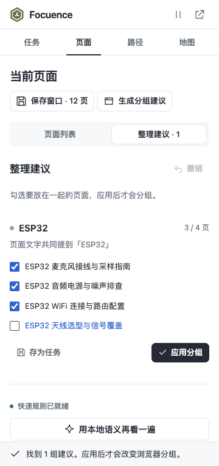
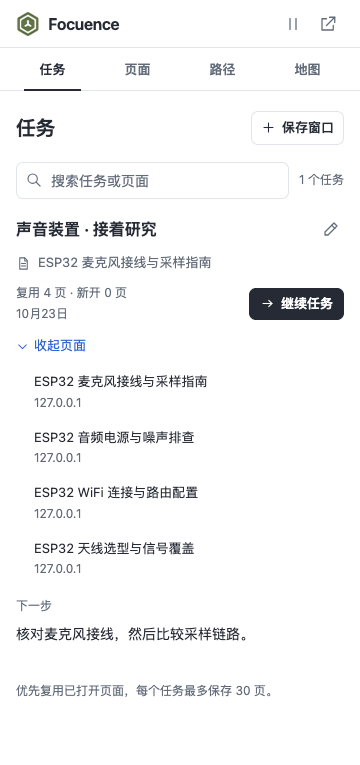
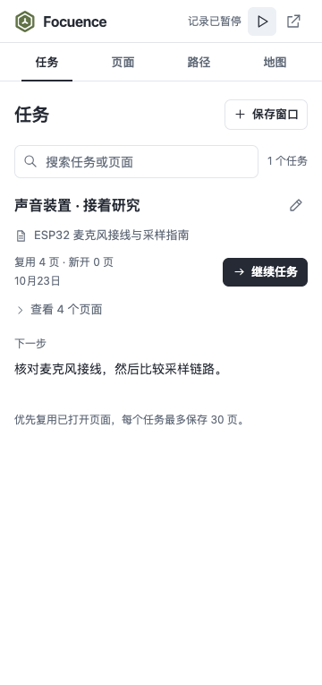
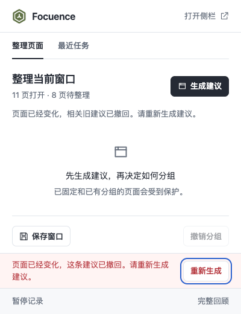
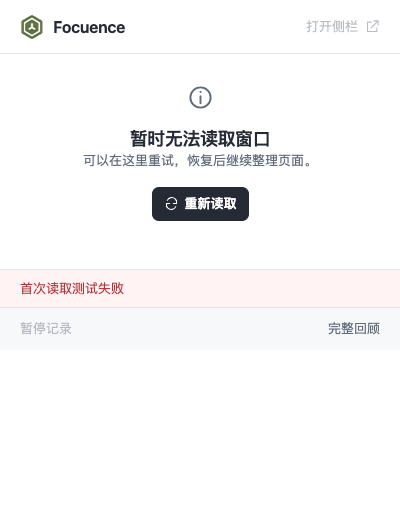

# Focuence 2.1.2 · 可信分组与就近操作

2026-10-23。基于 `56a2869` 的第三轮 Taste / Impeccable 独立评审与主线程原生能力审计实施。本轮继续沿用已确认的视觉体系和插件架构，没有新增模型、权限或数据库迁移。设计与接口见 [V2_1_2_ITERATION.md](../../V2_1_2_ITERATION.md)。

## 评审问题的处理

| 原问题 | 本轮结果 |
| --- | --- |
| P1 · 全部成员移到另一窗口后，旧建议仍可应用 | 建议绑定原窗口、版本和逐 tab 快照；后台核验完整原建议与所选子集，过期操作被拒绝。原生验证一页 / 全部四页跨窗移动，两个窗口均不被旧请求改变 |
| P2 · 关闭一页，实际分组 3 页却显示 4 页 | 旧建议整体撤回，重新生成后再确认；结果使用后台实际 `count`。在真实弹窗中复现刷新前点击旧按钮，拒绝后重新生成、应用 3 页和撤销均通过 |
| P2 · 导航后仍展示旧建议 | 状态读取核对标题、URL、正在导航的目标、固定与分组状态；受影响建议撤回并提供重新生成提示 |
| T1 / I1 · 建议埋在全部页面之后 | 侧栏提供“页面列表 / 整理建议”，生成后直接展示结果并定位标题；12 页原生样本首组结果从约 y=1485 移到 y=346（360×765） |
| T3 / I2 · 四个成员只展示三个，不能纠正 | 弹窗与侧栏共享选择口径，全部成员可检查与取消；原生四选三只分组所选三页 |
| T2 · 撤销离成功反馈太远 | 弹窗反馈旁可撤销；侧栏反馈使用独立底部空间，内容区域为其留位，避免覆盖列表 |
| T4 · 恢复前难以查看任务成员 | 三个入口共用成员展开与单页打开；最多 30 页的列表可滚动，继续按钮位于它之前 |
| I3 · 外部 tab 更新导致焦点落到 BODY | 页面、任务落点和路径按钮使用稳定标识；刷新保留焦点，条目消失后落到邻近页面或稳定区域。成员展开状态与滚动保留 |
| T5 / I4 · 排序指标不可见 | 每行显示最近访问 / 记录回退，或最近七天前台时长；明确只排序扩展列表，不移动浏览器标签栏 |
| I5 / I6 · 暂停状态不持久、首次失败没重试 | 暂停文字持续可见；弹窗初次读取失败可就地重新读取，加载期间防止重复提交 |
| T6 · 路径重复堆叠元信息 | 默认显示起点、时长和主题；完整区间与状态通过时间详情查看 |

## 验证与来源

- **71 项单元测试与构建通过**，新增 10 项建议契约回归。原有活动计时、分析、任务、日期、地图和备注测试保留。
- **20 组界面 / 交互检查通过**，覆盖 400×520/600 弹窗、320×720 / 360×765 侧栏、1280×900 完整地图。界面边界使用生产 UI 与可控内存示例数据；其中一组原生扩展冒烟验证覆盖分组 / 撤销 / 保存 / 侧栏 / 单页复用 / 缺页恢复 / 重复恢复。
- **12 组独立原生检查通过**：精确成员与顺序撤销、旧版本和重复提交、部分 / 全部跨窗、内容及保护状态变化、弹窗过期操作恢复、建议位置与纠正、排序口径、页面与任务焦点、持续暂停、创建 / 关闭刷新。
- **定向补验**覆盖反馈区域不遮挡内容和连续成功 / 失败 / 重试时不存在重复反馈动作。没有扩大成额外一轮整体视觉重设计。
- 使用隔离的 **Chrome for Testing 156.0.8078.47 / macOS arm64**，原生流程配合本轮创建的本地合成网页；没有读取个人浏览器资料。截图只捕获扩展内容区域。
- 初次检查发现反馈动画短暂阻挡命中、侧栏底部样式被旧选择器覆盖，已修复并补验。地图 SVG 和暂停状态的检查改为等待真实异步完成；一次 Chrome 测试启动超时在重试后核对，不作为产品测试失败或成功计数。

机器可读的最终结果见 [validation.json](validation.json)。本轮没有重新测量模型速度或分类准确率；规则与 BGE 推理算法未变。原生 API 没有原子状态比较交换，任意外部并发时刻不在该测试保证范围内；Windows / Edge、Chrome 120 和长期真实浏览仍未逐项实测。

## 截图

真实扩展、合成网页：建议直接出现，四个成员全部可检查，示例取消其中一页。

生产弹窗 UI、演示数据：实际应用数量与撤销并排，固定在内容区之外。

生产侧栏 UI、演示数据：结果反馈独占底部，不遮盖列表。

真实扩展、合成网页：任务成员可展开，暂停状态在提示消失后仍可见。

真实扩展：原成员已移出本窗口，旧建议撤回；刷新前应用失效建议也会被后台拦截并提供重试。

生产 UI、演示数据：初次读取失败可重试，路径详细时间可按需展开。

## 后续功能边界

把所选页面加入已有任务、移除任务成员、指定继续落点、跨弹窗 / 侧栏草稿接续、原生标签栏重排和新的预测算法仍是独立功能提案。本轮完成当前评审缺陷的整改，不把这些后续能力计为已交付。
