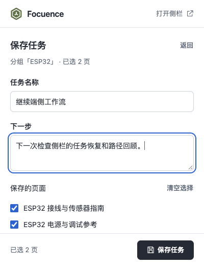
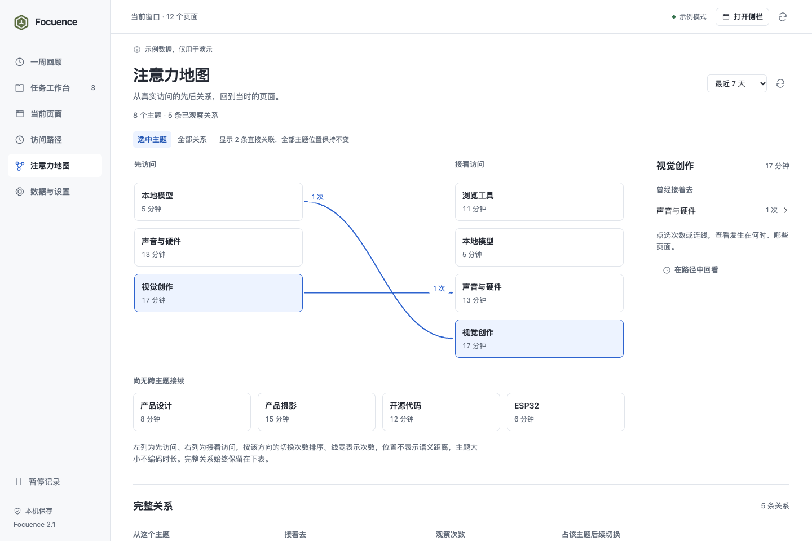

# Focuence V2.1 · UI 迭代记录

2026-10-22。保留已确认的三层浏览器扩展架构，按用户指定的两份独立评审重做日常界面。本轮直接提交源码、截图与验证证据，没有重新打包 ZIP。

## 评审与处理

原始审阅：[Taste](TASTE_REVIEW.md)（5.3/10，视觉与截图评审）、[Impeccable](IMPECCABLE_REVIEW.md)（25/40，启发式 UX 评估）。两份评分对应初版界面，以下是后续实施与验证记录。

| 评审问题 | 本轮处理 | 验证 |
| --- | --- | --- |
| 侧栏壳层过高、任务靠后 | 48px 工具头与单行导航；任务、下一步、真实页面和继续动作组成开放列表 | 360×765、320×720 示例首任务 y=222.5；首个继续动作底部 y=394.3，下一任务标题底部 y=459.0 |
| 弹窗保存动作不在屏内 | 独立固定底栏；名称、下一步和页面清单共用一个内容滚动区 | 400×520、400×600；保存按钮底部 507.5 / 587.5，清空选择不可提交，12 页完整保存 |
| 重复绿灰卡片、动作同权 | 中性工作面与石墨正文；蓝色选择/焦点；重新整理降级，继续/应用/保存按状态强调；删除移入编辑页 | 原生弹窗与侧栏截图；任务编辑和 Escape 返回入口 |
| 路径标题与时间粘连 | 侧栏时长进入元信息行；范围与刷新并排；页面对象优先 | 360px 路径截图，无横向溢出 |
| 圆泡与截断名称掩盖关系 | 局部有向图显示前后主题与次数；完整图采用访问角色两列，完整标签换行，孤立主题保留 | 4/8/20 主题的稀疏和密集图，无名称截断；20 主题全部模式保留 380 条关系 |
| 密集图连线互相遮挡 | 默认聚焦所选主题，可切换全部连线；主题位置不因聚焦而改变；关系表始终完整 | 20 主题聚焦 38 条直接关联；切换、选择与内部滚动保持上下文 |
| 回顾先展示大图、窄屏导航堆叠 | 先展示主题与任务，逐日柱图移到后面并去掉背景竖槽；窄屏使用模块选择菜单 | 1440px 与 390px 完整页；日期、共同基线及零值语义保留 |

## 当前截图

所有资料均为合成测试内容。native 为真实加载的扩展，demo 为明确标识的内存示例。

| 弹窗 | 侧栏 |
| --- | --- |
|  |  |

[七天回顾](after/weekly-desktop-demo.png) · [窄屏回顾](after/weekly-narrow-demo.png) · [原生路径](after/panel-native-path.png) · [原生轻量地图与访问证据](after/panel-native-map.png) · [320px 任务](after/panel-320-demo.png) · [20 主题压力图](after/map-20-dense.png)

初版截图保存在 before/，与两份历史评审中的链接一致。

## 验证证据

- `npm test`：54 项全部通过。新增地图测试覆盖循环、孤立主题、完整标签、确定性角色排序、局部直接关系与低次数选中边。
- `npm run build`：本机推理 worker 与匹配 WASM 构建成功。
- 11 个界面取景无横向溢出、重复 ID 或未捕获异常；6 个地图压力样例覆盖 4/8/20 主题的稀疏与密集关系。
- 原生工具栏分组、成员选择与焦点、保存名称/备注、应用/撤销、本机模型 ready、恢复复用、部分失败与重试、原生侧栏和页面变化、路径/关系证据、七天回顾分别完成验证。
- 导出单独用完整页的实际导出按钮 DOM 激活，核对下载的 JSON：schemaVersion=2，包含保存的两页、备注及实际恢复结果。不是只调用后台接口验证。
- 代表性正文对比度 14.39:1、辅助文字 5.39:1、聚焦图边 5.53:1；本次不等同于完整无障碍认证。
- Impeccable 手动检测返回空结果；视觉与流程结论以上述截图和实际检查为依据。

原生自动化分次完成：完整流程曾在导出前遇到后台页的动画帧等待超时，另有弹窗生命周期/窗口焦点造成的自动化重试。已完成的核心动作保留取证，导出使用独立隔离配置核验下载文件；未把自动化脚本整体失败写成一次完整通过。

检查均使用 macOS 的 Chrome for Testing 156.0.8078.47 与任务专用隔离配置，不读取日常浏览器历史。原生模型测试使用仓库已有的本机模型资产。

## 交付边界

本轮没有变更后台模型架构、自定义标签或云功能。Windows、Edge、长期真实浏览和大批量页面分类质量仍未逐项实测。改版后按上述标准验收，没有追加独立 agent 评分。

[产品约定](../../../PRODUCT.md) · [视觉与模块设计](../../../DESIGN.md) · [插件入口](../../V2_EXTENSION_SURFACES.md)
