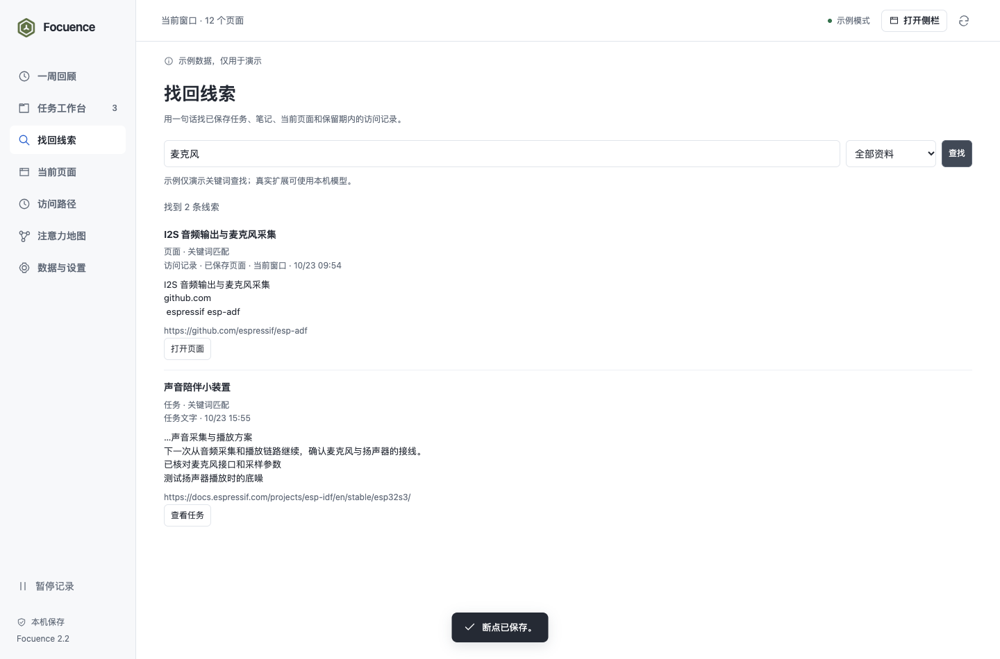
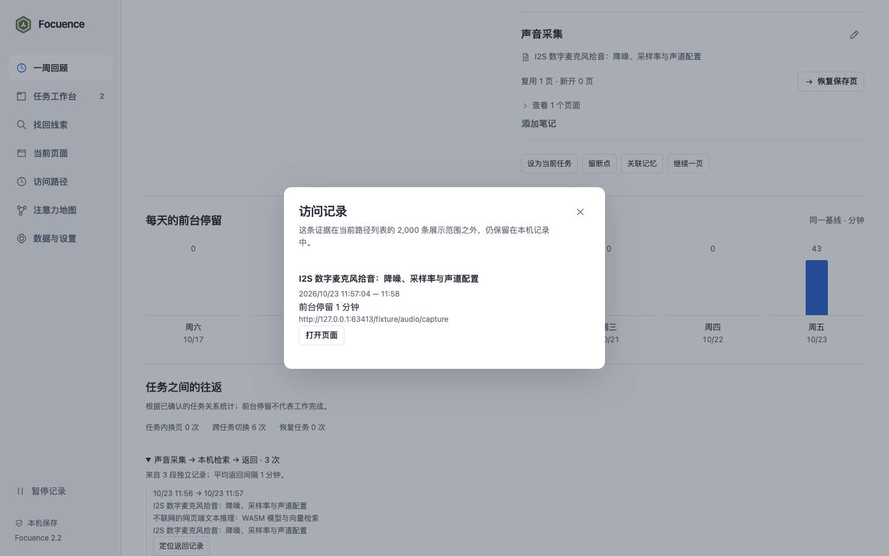

# Focuence 2.2.0 验收记录

2026-10-23。按[已批准的任务记忆方案](../../plans/2026-10-23-001-feat-task-memory-attention-plan.md)完成五个方向、六个实施单元，交付源码、文档和验证资料。初次验收后，用户追加授权沿用原 main 分支提交与推送；打包和发布不在本轮范围内。

本轮由主线程实现与验收，没有新增 agent 或独立评审。界面样例、网址、任务、访问片段及提示触发数据均为合成资料；没有读取日常浏览器历史。

## 已实现

- 每个窗口独立的当前任务与目标；可先新建目标再关联资料。页面确认归属和工作意图分别记录，共享页面不会按任务顺序任意归类。
- 跨站资料候选、相关/不相关记忆、撤销与重置。关联和最多 30 页的恢复清单分开，用户纠正优先于模型。
- 用户确认的进展、卡点、下一步、继续页及可选访问证据。保存并暂停/切换，单页继续与全部恢复，冲突保留草稿并明确核对。
- 四个范围的关键词与本机语义找回，长笔记分段，逐批进度、取消、失败重试、来源和匹配片段。
- 默认关闭、仅侧栏可见的低频返回支持；独立时段的任务往返、重复找回及可打开的原始证据。
- 数据库结构 1→2、导出格式 3；清除历史保留确认记忆，关联可单独清除；旧请求和迟到向量不能恢复已清理内容。

## 环境与检查结果

环境为 macOS arm64、隔离 Chrome for Testing 156.0.8078.47，实际加载 MV3 扩展、随包 q8 BGE 模型和真实 IndexedDB。原生窗口、侧栏和工具栏弹窗使用独立浏览器配置；有焦点要求的检查在有界面浏览器中执行。

| 检查 | 结果与证据 |
|---|---|
| 逻辑回归 | 113/113 通过，0 失败、0 跳过；[测试输出](final-tests.tap) |
| 构建 | 2.2.0 本机 worker 与 WASM 构建成功；[构建输出](build.txt) |
| U1 数据与上下文 | 真实 v1 数据升级后旧笔记、片段完整；真实事务回滚；多窗口独立、并发旧修订被拒；worker 保留意图，浏览器重启释放绑定。见 [native-01](native-01.json)、[native-02](native-02.json) |
| U2 断点与恢复 | 单页落点可在恢复清单外；全失败不切换目标，部分失败重试复用成功页；原生弹窗冲突保留草稿并显式重读。见 [native-01](native-01.json)、[native-02](native-02.json) |
| U3 关联与本机模型 | 跨站固定页面实际语义匹配；明确排除/撤销、重启记忆与语义故障回退；修改或禁用后旧任务失效。见 [native-01](native-01.json)、[native-02](native-02.json)、[native-03](native-03.json) |
| U4 完整检索与竞争 | 113 个文本分段，在完成 24 个后关闭 worker，继续到 113/113；覆盖长笔记末尾。延迟推理下取消/新查询不被旧结果覆盖；失败时可编辑任务并重试。见 [native-03](native-03.json) |
| 清理与升级阻塞 | 升级阻塞提供关闭/重试提示，放行后无遗留连接；清理期间迟到推理返回 stale，向量数为 0。见 [storage-lifecycle](storage-lifecycle.json) |
| U5 提示与模式 | 合成六分钟访问证据在真实侧栏显示一次，按可见展示确认，相关纠正生效，旧提示拒绝；三段往返和三个日期的找回有真实记录入口，包括 2,000 条列表范围外的证据。见 [native-02](native-02.json)、[focus-03](focus-03.json)、[pattern-evidence](pattern-evidence.json) |
| U6 三个入口 | 320/360×760 侧栏、400×520/600 弹窗、1440×950 完整页；当前任务、断点、搜索、目标先建、输入边界与草稿、键盘焦点、错误重试、空结果、地图回归，无横向溢出、重复 ID 或页面脚本错误。见 [ui-01](ui-01.json)、[final-ui-model](final-ui-model.json) |
| 原功能回归 | 真实原生规则分组、精确成员应用和撤销；任务去重/部分失败恢复；地图及既有逻辑测试通过。见 [native-03](native-03.json) 与测试输出 |

提示检查使用带明确任务归属的合成访问片段，不声称实时等待六分钟或证明用户产生偏离。时间、空闲、未知、冷却与每日上限另由确定性边界测试覆盖。demo 只演示关键词结果，界面注明；模型结果由实际原生扩展产生，两类证据分开。

## 实际模型结果

固定样本包括麦克风拾音、音箱功放、电源管理、网页端离线推理、扩展接口、面包发酵、京都旅行和 Blender 灯光等页面元数据。每次查询在调用模型前先检查关键词结果。

| 查询 | 预设目标 | 关键词排名 | 实际语义排名 |
|---|---|---:|---:|
| 如何把人声变成数字信号 | I2S 数字麦克风拾音 | 未命中 | 1 |
| 离线运行人工智能的浏览器资料 | 网页端本地模型与向量检索 | 未命中 | 1 |
| 烘焙时面团要等多久 | 酵母面包发酵 | 未命中 | 1 |
| qxjv-9472-zztp | 无预设目标 | 无结果 | 无结果 |

[三查询比较](native-03.json)在三个页面子集上各只返回目标结果；[八页面集合](native-01.json)也将相应目标排第一。跨站固定资料与目标的真实模型匹配分数约 0.602，仅用于内部排序，不作为正确率展示。

最新一次独立浏览器配置中的八页面检索，首次加载与分析 **1,206 ms**，相同查询复用缓存 **54 ms**，包括请求与检索流程。[原始记录](final-ui-model.json)保留结果、范围与耗时。这是单机样本，受系统缓存和当时负载影响；不是性能保证，也不是广泛召回率评估。

## 截图

下面的任务和查找截图使用明确标识的合成 demo；它们展示最终界面。原生侧栏提示、弹窗冲突与历史证据来自真实扩展验证。

| 任务侧栏 | 工具栏弹窗 |
|---|---|
|  |  |

更多边界画面：[320 侧栏](screenshots/panel-320-boundary.png)、[520 高弹窗](screenshots/popup-520-boundary.png)、[原生断点冲突草稿](screenshots/native-popup-checkpoint.png)、[完整地图回归](screenshots/map-regression.png)。

## 修正与限制

验证中修正了窗口/任务版本冲突、旧检索覆盖、提示 ID 重用、继续页与恢复清单混淆、长笔记命中片段显示、弹窗滚动遮挡，以及升级受阻后的连接清理。确认的断点和手工关联不会被清除历史误删。

首次提示样本曾混入此前合成访问片段，触发连续性保护而未显示；清空样本历史、重新构造一致时间轴后，完整原生检查和单独侧栏检查均通过。加载状态检查改为可控的推理等待，避免短暂状态被自动化采样错过。这些是验证夹具修正，没有降低触发或验收条件。

本轮必要项已通过。Windows、Edge、长期真实浏览及远大于本次样本的性能尚未实测；没有进行新的独立设计评审或完整读屏认证。实际任务相关性与效率收益仍需日常使用验证。数据留在本机，不新增浏览器权限、云端推理或网页正文抓取。
