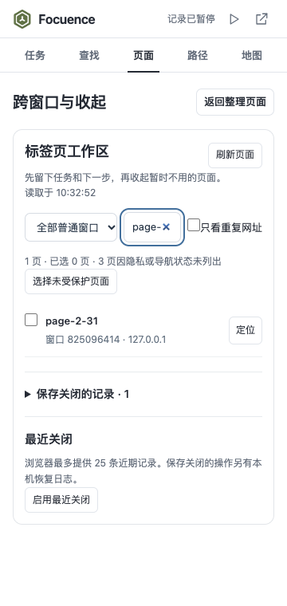
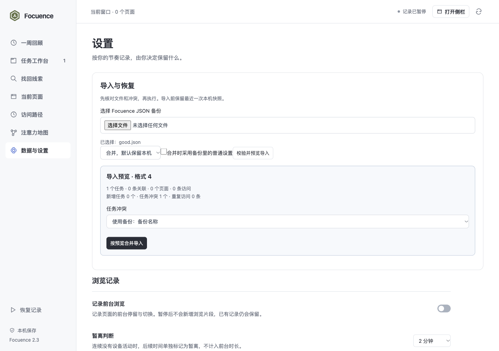

# Focuence 2.3.0 验收记录

2026-10-24。按[已批准的三个阶段计划](../../plans/2026-10-23-002-feat-browser-workspace-memory-plan.md)完成 U1—U4 和 2.3 的阶段验收，后续继续 2.4、2.5。本轮在原 main 由主线程实现与检查，没有新增 agent、分支或独立评审。

## 已交付

- 任务进行中、等待、完成、归档、重新开始，以及三端状态筛选。转换一次释放所有相关窗口的当前意图，保留断点和资料。
- 当前窗口/全部普通窗口目录、查找和严格重复候选。重复使用完整 URL，关闭选择绑定 SHA-256 身份；固定、当前、播放和已分组页面逐项确认。
- 任务、断点与关闭日志先持久保存，再逐页关闭。保存失败关闭数为零；浏览器失败逐页记录，worker 回收后不自动续关。恢复本次关闭保留重复页数量，原任务恢复仍去重。
- 最近关闭的可选 sessions 权限及实际会话恢复；混有排除/不支持成员的窗口禁止整体恢复，只可打开已列出的合法网址。
- 格式 2—4 的备份校验、逐任务冲突、默认保留本机的合并、整体恢复与最近一个恢复前快照。预览过期不覆盖，配额/事务错误原子回滚；清除历史同步移除内部恢复点。
- 数据库结构 2→3、导出格式 4。原名称和笔记保留，旧任务默认进行中；权限、临时窗口绑定、向量和未完成关闭动作不从备份恢复。

## 环境与结果

macOS arm64、Chrome for Testing 156.0.8078.47、实际 MV3 扩展、原生 IndexedDB 与随包 q8 BGE。所有标签、文件、任务和输入均为隔离配置中的合成数据，没有读取个人历史。

| 检查 | 结果与证据 |
|---|---|
| 逻辑回归与新规则 | 126/126 通过，无失败或跳过；[完整输出](tests.tap) |
| 构建 | 本机 worker 与匹配 WASM 成功；[输出](build.txt) |
| 数据、窗口与批次 | 实际 v2→v3 升级，原子导入、重复导入、事务中止、清除内部恢复点；三个窗口 100 页；重复页关闭/恢复及重试，旧导航预览拒绝，多窗口任务完成。见 [native.json](native.json) |
| 恢复与故障 | 升级阻塞后重试；真实文件选择、损坏文件草稿、冲突选择与导入；原生 IDB 写入处注入 QuotaExceededError，实际事务和快照一起回滚；31 个资源拒绝且未关闭；部分关闭故障；原生分组复用并保留用户新组名；真实 worker 终止后不续关；实际 sessions 授权及恢复。见 [recovery.json](recovery.json) |
| 三端界面 | 320/360×760 侧栏、400×520/600 弹窗、1440×950 完整页；输入超限保留草稿、关闭预览、一次实际界面执行、归档筛选/重启；通过真实浏览器 action 打开的工具栏弹窗。无横向溢出、重复 ID、意外布尔文字或未捕获脚本错误。见 [ui.json](ui.json) |
| 实际模型回归 | 八份合成页面元数据，三个中文查询最终预设目标均为第一，无意义查询无结果。见 [model.json](model.json) |

模型的第二个查询“离线运行人工智能的浏览器资料”先由关键词返回“浏览器扩展接口”，实际向量补充后“网页端本地模型与向量检索”排第一。其他两个查询关键词已含预设目标，不声称全部关键词未命中。独立临时配置的首次查询为 632ms，后两次 27/24ms；仅是此次单机小样本，不是性能保证或召回率评估。

## 截图

| 侧栏工作区 | 实际工具栏弹窗 |
|---|---|
|  |  |

边界画面：[320 侧栏关闭预览](screenshots/panel-320x760-preview.png)、[520 高弹窗预览](screenshots/popup-400x520-preview.png)、[完整页预览](screenshots/app-1440x950-preview.png)。

## 验证说明与限制

配额故障使用原生 IDB 写入点的确定性 QuotaExceededError 注入，验证真实事务中已经排队的任务写入和恢复点都被回滚；没有耗尽用户磁盘，也没有把 DevTools 配额覆盖当成操作系统空间耗尽。浏览器单页关闭失败同样是明确的 API 故障注入，成功的关闭、恢复和 worker 终止使用真实浏览器操作。

验证夹具修正了内置扩展 worker 的误选、尚未启用按钮的点击时机、窄窗口命中位置，以及浏览器子进程退出时的配置清理竞争；最终所有原生检查重新通过。顺序执行逻辑测试减少当前机器的并发进程压力，未省略测试。

仅恢复保存的网址及可恢复的页面组织信息，不保存表单、登录状态或页面运行状态。最近关闭受浏览器自身列表限制。Windows/Edge、长期真实使用和更大规模分类质量未实测。当前只是第一阶段通过，浏览器历史接入和研究资料库按计划继续实施。
