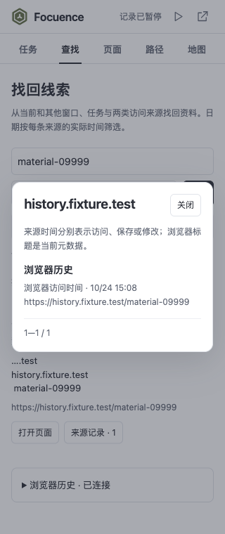
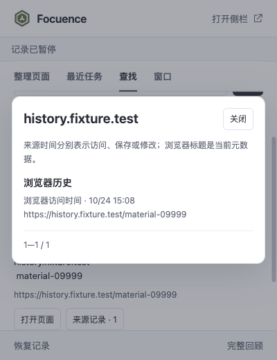

# Focuence 2.4.0 验收记录

2026-10-24。按[已批准计划](../../plans/2026-10-23-002-feat-browser-workspace-memory-plan.md)完成 U5—U6 和第二阶段验收；在原 main 主线程实施，没有新增 agent 或分支。2.5 继续实施。

## 交付

可选 history 权限由点击申请，主动导入最近 7/30/90 个本地日的本设备实际 visits；与前台时长分开。持久游标支持停止、继续、失败重试与 worker 重启，饱和时间窗口细分，不能完整枚举时明确失败。收到删除事件先清理再核对剩余访问，手动刷新完整对账。撤权、断开、清理及新代次阻止迟到写入。清除扩展历史不调用浏览器删除接口。

统一检索覆盖所有普通窗口、保存任务、自记录访问和浏览器历史。来源、日期、域名和两种任务含义先于语义分段过滤；按资源合并仍保留标题变体及全部来源。昨天、上周和最近 N 天按本地日历解释，支持修改；结果与来源记录均可分页。当前开着的页面可跨窗口定位。历史缓存不进入交换备份；数据库升级至 4，格式 2—5 可导入，导出为 5。

## 证据

环境：macOS arm64，Chrome for Testing 156.0.8078.47，隔离配置、实际 MV3、原生 IndexedDB 和随包 q8 BGE。仅使用合成资料，没有访问个人历史。

| 验收 | 结果 |
|---|---|
| 逻辑与回归 | 140/140，通过且无跳过；[原始输出](tests.tap) |
| 构建 | [构建输出](build.txt) |
| 原生历史、持久化与三端 | 10,000 次 Chrome 实际合成访问，逐项对照 native visitId；真实授权、取消/worker 终止/继续、删除单项和全部、撤权、缓存清理、v3→v4、真实事务回滚、全量分页；320/360×760 侧栏、400×520/600 弹窗、1440×950 完整页均可查看来源，无横向溢出、重复 ID 或未捕获脚本错误。见 [history.json](history.json) |
| 实际模型 | 八份元数据、三个中文查询均将预设目标排第一，无意义查询无结果；见 [model.json](model.json)。其中离线模型样本从关键词的浏览器扩展结果改为模型资料第一；其他查询不声称关键词漏检 |
| 规模、缓存和取消 | 1,000 个资源、100 个任务，共 1,100 分段，完整处理后再验缓存；24 段后停止，未继续处理其余范围。记录真实耗时、隔离浏览器进程 RSS 和控制页面堆；见 [performance.json](performance.json) |

时间与内存是单次本机观察，受当前负载影响；进程 RSS 包含浏览器及其子进程，不代表扩展独占内存或峰值。性能样本采用已知标题查询，关键词已经可命中，用于验证完整模型覆盖、缓存及取消，不作为语义召回率证明。

探索中，宽泛查询“没有网络时怎样用人工智能找回读过的网页”在大量近似任务文字中未把预设“端侧模型”页面排进前 50；见 [原始探索结果](performance-exploration.json)。这项质量限制保留：相似任务和信息不足的标题可能挤占结果，筛选和来源核对仍然必要，不能把语义分数当事实。未更换模型或为此减少检索范围。

## 界面

## 修复与限制

本轮修复标题变体分段参数、来源变化失效，以及较旧界面快照误判新查询过期的竞争。原生验收启动/退出曾受本机资源压力延迟；最终串行重跑。权限拒绝、同步访问排除、密集同刻窗口、夏令时、API 失败和迟到批次由逻辑测试覆盖，真实授权、撤权、删除和事务由原生流程覆盖，不互相冒充。

浏览器历史标题是当前元数据，不是每次访问当时的标题。即时删除核对受 Chrome 事件粒度限制；手动刷新执行完整对账。Windows/Edge 和长期真实使用没有执行。本阶段没有引入正文抓取、云端分析或新模型。
