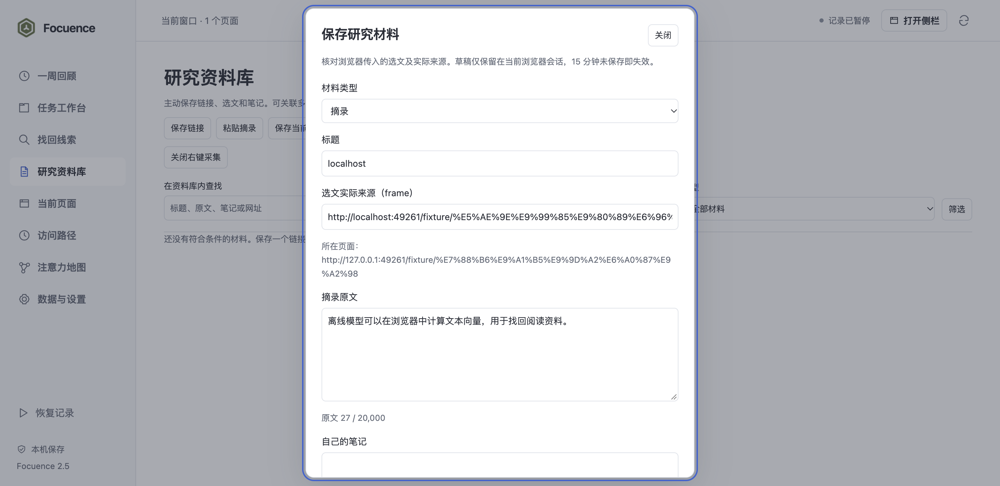
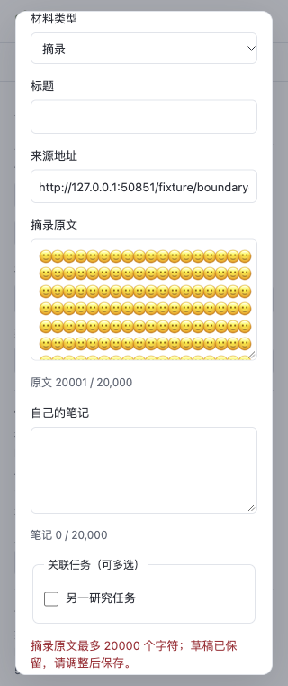
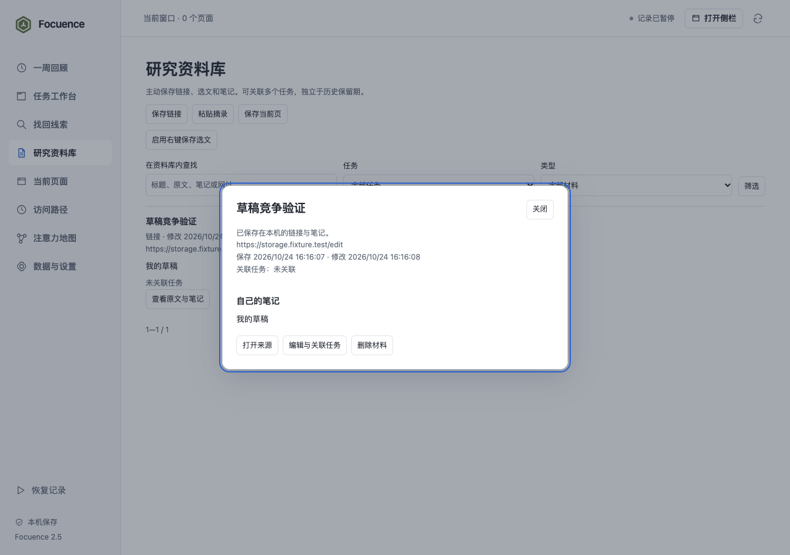

# Focuence 2.5.0 与三个阶段最终验收

2026-10-24。按[已批准计划](../../plans/2026-10-23-002-feat-browser-workspace-memory-plan.md)完成 U7、U8，完整交付 2.3—2.5。沿用原 main，由主线程实现与检查，没有新增 agent、分支、worktree、云服务、新模型或全站脚本权限；没有把自检称为独立评审。2.3、2.4 已分别提交推送，本版在验收通过后提交推送。

## 本版交付

- 研究资料库支持链接、选文原文、自己的笔记及多任务关联。原文和笔记分别最多 20,000 个 Unicode 码点，超限保留输入；正式材料不随历史保留期删除，网页变化不自动改写原文。
- 同来源同原文可明确复用，保留原题与原文；新增任务关系可合并，新笔记须明确追加。修订冲突保留草稿，读取最新内容供核对后再确认保存；已删除任务可更新列表后重新选择。
- 可选右键入口只在用户点击后接收浏览器 selectionText。拒绝输入区域、无痕及排除来源；实际 frame 与父页面分别保留，不冒用父标题。先核对再保存，15 分钟会话草稿受读取期限与真实闹钟清理约束。
- 材料以独立身份进入统一检索；标题、原文和笔记分别分段，并标明命中字段。同网址页面不会吞掉摘录。侧栏可按材料和窗口 ID 转到完整工作台；失效材料有明确反馈。
- 数据库结构升级为 5，格式 6 完整导出材料，格式 2—6 校验导入。材料冲突可逐项选择，整体恢复列明移除数量；材料和恢复前快照同事务提交。清除历史保留材料，删除任务仅移除该任务关联，清除全部包括材料和临时选文。
- 修复立即重试恢复的边界：通过本次恢复记录和 pendingUrl 复用仍在加载的标签，避免再次打开。待导航目的地改变时不复用。

## 环境与结果

macOS arm64，Chrome for Testing 156.0.8078.47，实际 MV3 扩展、原生 IndexedDB、原生菜单和随包 q8 BGE。数据全部为隔离配置中的合成资料，没有读取个人浏览历史。

| 验收 | 结果与原始证据 |
|---|---|
| 逻辑、回归和构建 | 148/148，无失败或跳过；[测试输出](tests.tap)、[构建输出](build.txt) |
| 完整材料路径 | 13 组：留断点并实际关闭 → 恢复 → 从实际浏览器历史找页 → 共享表单保存摘录及双任务关联 → 跨任务检索 → 导出/冲突选择/整体恢复与恢复前快照。含长文模型、纯文本 HTML、旧修订、原子回滚、保留期与删除任务、五种尺寸草稿保留。[library.json](library.json) |
| 实际右键选文 | 2 组：通过原生菜单点击保存跨源 iframe 选文，核对实际/父来源、确认后保存、成功后清除会话草稿、关闭菜单权限。[capture.json](capture.json) |
| 存储、冲突和入口 | 6 组：真实 v4→v5 迁移保留旧文字/历史源；删除材料使旧结果失效；编辑冲突读取最新内容且保留草稿；侧栏转完整页保留材料/窗口 ID、Escape 关闭；真实过期闹钟；worker 终止后草稿续用及清除全部。[storage.json](storage.json) |
| 大规模历史与来源 | 16 组：10,000 次真实 Chrome 合成访问逐项比对原生 visitId；停止、worker 终止、继续，删除单项/全部、撤权、清缓存，原生事务回滚、完整分页和五种尺寸来源查看。[history.json](history.json) |
| 标签工作区与可靠备份 | 11 组：v2→当前迁移、原子导入/失败回滚、三个窗口 100 页、重复页保存关闭恢复及即时重试、旧预览拒绝、多窗口任务状态。[native.json](native.json) |
| 恢复与故障回归 | 10 组：升级阻塞、并发编辑、真实文件选择/冲突、原生写入点配额异常、31 页拒绝、原生分组、部分关闭故障、真实 worker 终止及 sessions 授权/恢复。[recovery.json](recovery.json) |
| 三端旧流程回归 | 14 组：320/360×760 侧栏、400×520/600 弹窗、1440×950 完整页，关闭预览、草稿、状态筛选/重新开始和真实工具栏弹窗；无横向溢出、重复 ID 或未捕获脚本异常。[ui.json](ui.json) |
| 实际小样本模型 | 4 组：八个页面、三个中文查询的预设目标排第一；无意义查询无结果。[model.json](model.json) |
| 1,000 资源规模 | 3 组：1,100 分段全量处理、缓存、24 段后停止，以及实际日期/错误草稿界面。[performance.json](performance.json) |

以上为 79 组脚本检查，包含明确标注的故障注入，不等于 79 次独立用户实验。

长材料原文和个人笔记合计约 39,000 码点，实际处理全部 422 个分段；中文同义查询命中摘录末尾的麦克风/模数转换原文，结果方法为 semantic，另一查询命中个人笔记末尾。没有用截断语料通过验收。

1,000 资源单次测量为首次 17,533ms、缓存后 3,202ms；24 段后停止响应 10ms。隔离浏览器及子进程的采样 RSS：开始 923,856KiB，缓存轮后 882,656KiB；这不是扩展独占内存、峰值或性能承诺。历史 10,000 次访问导入并逐项比对为本次续传后 27,488ms、49 个完成窗口，完整时间包含停止前的准备步骤以外的实际续传过程，见原始记录。

## 界面证据

另见[真实工具栏弹窗](screenshots/actual-toolbar-popup.png)及 [400×520 材料表单](screenshots/popup-400-520-library.png)。原文与笔记独立，长表单可滚动，键盘可关闭；错误反馈保留全文。

其他尺寸：[360 像素侧栏](screenshots/panel-360-760-library.png)、[400×600 弹窗](screenshots/popup-400-600-library.png)、[1440×950 完整页](screenshots/app-1440-950-library.png)。

## 检查方式与限制

菜单验证最初遇到多个同名 Chrome 实例的原生定位问题。最终在临时目录使用原有官方浏览器应用的 APFS 克隆，文件内容未修改、未重签名、未全局安装；原生工具按唯一应用路径定位并实际点击“保存选文到 Focuence”，没有用伪造事件替代。测试结束清理本次配置与临时应用副本。

配额检查在真实 IDB 写入点注入 QuotaExceededError，验证实际事务连同恢复点回滚；没有耗尽用户磁盘。过期检查把合成草稿设为已到期，然后通过真实 Chrome alarm 触发清理，没有声称等待了 15 分钟。Chrome 120 的菜单回调、History.isLocal 等接口边界依据[官方菜单文档](https://developer.chrome.com/docs/extensions/reference/api/contextMenus)与[历史文档](https://developer.chrome.com/docs/extensions/reference/api/history)核对；实际运行环境为 Chrome 156。

Windows/Edge、最低 Chrome 120 的实际运行和长期真实用户收益未实测。语义匹配仍需核对来源；[2.4 的宽泛查询排序限制](../v2.4/README.md)继续适用，本轮没有把合成流程验证当作真实召回率或效率收益。浏览器删除事件的即时粒度、最近关闭的有界列表，以及仅恢复网址/可恢复组织信息的限制保持有效。

2026-10-24 后续进行了以注意力地图和聚焦为核心的[三方独立评审与主线程复核](core-review-2026-10-24/README.md)，新增确认了检索连续操作、返回提示和自动候选的问题，尚未修复。原阶段验收输出保留，新增问题状态以该复核记录为准。
