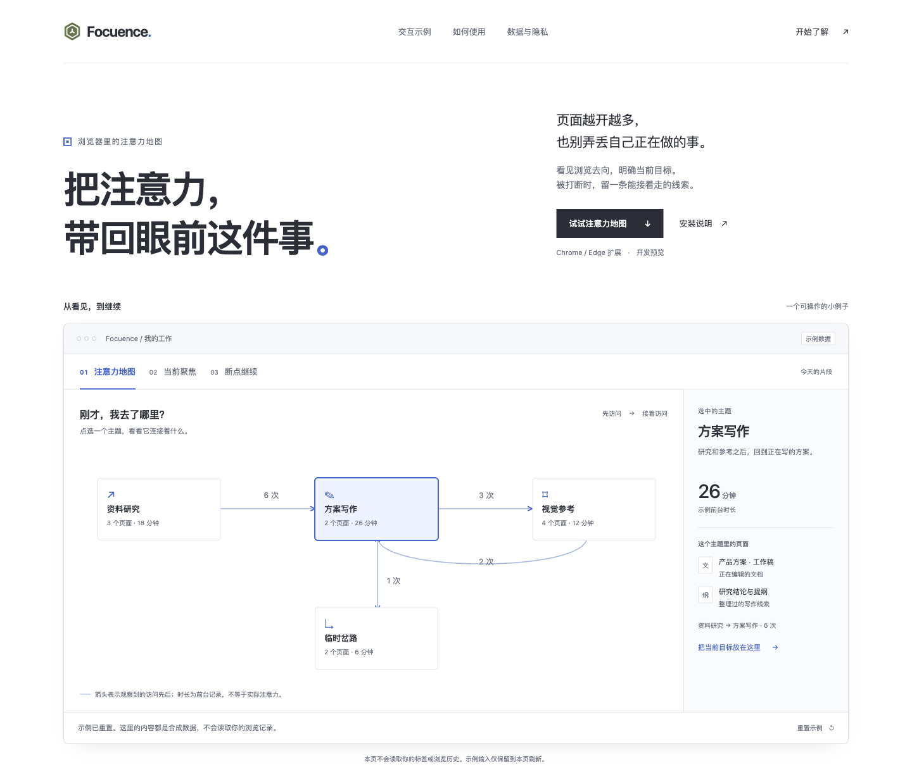
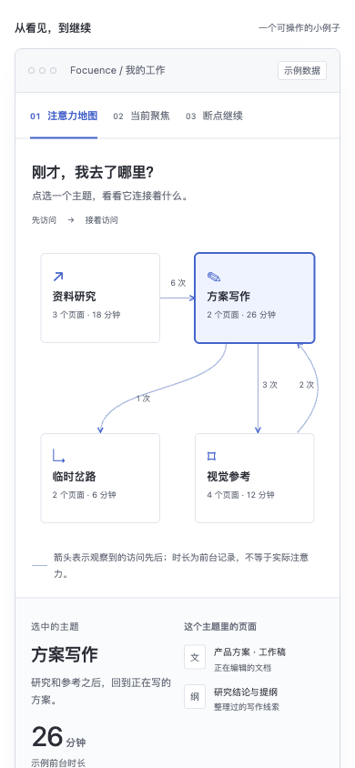

# 官网验收 · 2026-10-25

发布版本：`focuence-site-7e1b2add0bb6`。

- [aitoshuu.me/Focuence](https://aitoshuu.me/Focuence)
- [tongye.me/Focuence](https://tongye.me/Focuence)

## 交付

原生 HTML/CSS/JavaScript 官网，保留现有浅色、石墨色与蓝色焦点视觉，以注意力地图、当前聚焦、断点继续为主。地图主题可选择并查看合成页面与先后线索；目标、下一步、断点联动，支持继续与重置。输入不写入持久存储。安装入口、开发预览状态与数据边界均明确说明。

腾讯独立静态源站保存构建白名单产物，两个现有公网 HTTPS 入口按路径转发，保留各自域名。原主站、证书、DNS 与其它应用配置保留。部署结构与回滚边界见 [官网部署](../../WEBSITE_DEPLOYMENT.md)。

## 检查结果

使用 egolite 0.6.1.9 进行真实浏览器交互和视觉验收，使用标准 HTTP 客户端独立核对响应及文件哈希。无新 agent 或独立 CLI 评审；本任务没有重跑扩展原生或模型验收。

| 范围 | 结果 |
| --- | --- |
| 本地交互 | 4 个主题、键盘标签切换、空白目标拒绝、目标联动、断点保存与继续、重置，全部通过 |
| 布局 | 320、360、390、768、1440 像素无页面横向溢出；手机地图完整显示四个主题 |
| 额外边界 | 保存状态恢复会清除旧输入校验错误；源码以 `textContent` 渲染输入，未使用 HTML 注入 |
| 构建 | JavaScript 语法通过，CSS 构建无警告；产物仅五个白名单文件，全部哈希通过 |
| 公网检查 | 两个域名各 10 项，共 20 项通过，详见 [结构化证据](verification.json) |
| 原站检查 | aitoshuu.me 保持原 994 字节页面及发布标记；tongye.me 保持原 `/experience/` 跳转与挂载标记；该既有体验页也返回 200 |
| 线上交互 | tongye.me 实际完成主题选择、目标编辑与保存，地址仍在该域名；aitoshuu.me 带尾斜杠页面实际选择主题，手机无横向溢出 |
| Nginx | 源站与公网入口配置校验通过；源站已有默认虚拟主机名称重复警告，与本任务无关，未修改该全局配置 |

初次线上验收发现 `/Focuence/` 的文件 alias 被当作目录，返回 500；已改为从站点根目录 `try_files /index.html =404`。修正后重新执行全部 20 项公网检查，两个带尾斜杠入口均为 200，内容哈希与无尾斜杠入口一致。

## 视觉证据

保留两张正式线上截图，其他中间截图、临时发布脚本和传输文件清理。

## 未包含的工作

本次发布的是官网与交互示例，未把扩展改成云端网页应用，未修复此前确认的四项扩展核心问题，也未发布稳定版扩展包。2026-10-25 验收时，官网与此前评审/清理改动尚未提交；2026-10-26 按用户要求分组归档到现有 main 分支，未新增分支或工作树。
